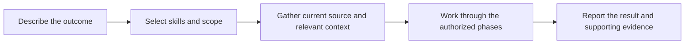

# Skills for Lazy Developer
<!-- Author: Raditte Anggoro | Provenance: RA.CODEXSKILLS.2026.10 | Metadata: docs/provenance.json -->

[](LICENSE)
[](#skills)
[](#development)

**Describe what you need. The agent selects the workflow and works within your scope.**

Skills for Lazy Developer is a portable instruction pack for coding agents. Its adaptive
router coordinates 16 workflows for implementation, debugging, browser and UI work,
architecture, security, and transaction integrity.


[What's new in V4](#whats-new-in-v4) · [Quick start](#quick-start) · [How routing works](#how-routing-works) · [Skills](#skills) · [Specialist roles](#specialist-roles) · [Repository layout](#repository-layout)

## What's new in V4

### Context intelligence

| Capability | How it works |
| --- | --- |
| **Targeted source retrieval** | Searches explicit paths within a project. Each excerpt carries its source path, line range, and revision fingerprint. The agent can reopen the full current file when a decision depends on omitted context. |
| **Lightweight or reusable indexing** | Uses native reads for simple tasks, an in-memory index for one-off retrieval, or a project-local SQLite index for repeated lookups. Changed files are reindexed, and lookup can fall back to lexical matching. |
| **Focused context packets** | Preserves user constraints, relevant facts, and recovery information. Optional compaction reduces routine noise while retaining access to the original evidence. |
| **Scoped session memory** | The optional Engram integration retrieves relevant project history on resume. It filters stale or expired records when revision or expiry metadata is available. Current source has priority. |
| **Adaptive native and MCP tooling** | Chooses tools by capability. Hosts with on-demand discovery can inspect the schema of the required tool from an existing, authorized connection. Native tools provide a fallback when they can supply the same evidence. |

[Context architecture](docs/context-intelligence-v4/04_PROPOSED_CONTEXT_ARCHITECTURE.md) · [Tool selection](.agents/skills/adaptive-workflow/references/tool-selection.md) · [Security boundaries](docs/context-intelligence-v4/09_SECURITY_LICENSE_REVIEW.md)

### Enterprise financial engineering

The router loads `transaction-safe-engineering` when a task involves financial or
transaction integrity. The workflow reviews where ownership, idempotency, transaction
boundaries, and ledger invariants must hold across a retry or interruption.

| Area | What the workflow covers |
| --- | --- |
| **Spring Batch and Java** | Chunk boundaries, transaction managers, checkpoints, restartability, and source-anchored review of batch and monetary code. |
| **Staging and posting** | Stable event keys, ownership and lease fencing, safe replay, and keeping posting and completion state consistent. |
| **Ledger and reconciliation** | Duplicate repayments, balanced entries, mismatched payloads, reconciliation, recovery, and audit trails. |
| **PostgreSQL and Oracle** | Dialect-specific SQL guidance for claiming and posting, query-plan review, migration safety, and rollback. |

[Spring Batch guide](.agents/skills/transaction-safe-engineering/references/spring-batch-safety.md) · [Staging and posting](docs/enterprise-financial-engineering/STAGING_POSTING_ARCHITECTURE.md) · [Ledger invariants](docs/enterprise-financial-engineering/LEDGER_AND_IDEMPOTENCY_INVARIANTS.md) · [Database comparison](docs/enterprise-financial-engineering/POSTGRESQL_ORACLE_COMPARISON.md)

## At a glance

- **17 skills** load by task and phase, with focused references when needed.
- **Four optional read-only specialist roles** support bounded exploration and review.
- **Optional project memory** through host-specific Engram adapters.
- **Portable installation** with a read-only preview, verified manifest, backup, and rollback.

## Quick start

### Get the repository

```sh
git clone https://github.com/RaditteAnggoro/skill-for-lazy-developer.git
cd skill-for-lazy-developer
```

You can also use the source ZIP or the [Codex plugin manifest](.codex-plugin/plugin.json).

### Install preview

Preview what would be imported, conflicts, and missing host dependencies. Add the
optional flags for specialist roles, project memory, or browser capabilities.

```sh
python scripts/agent_setup_preview.py --target /path/to/your-project
python scripts/agent_setup_preview.py --target /path/to/your-project --with-roles --with-memory --with-ui
```

Engram, browser tools, and MCP connections are separate host capabilities. The preview
identifies which dependencies the target already exposes. [Setup preview guide](docs/SETUP_PREVIEW.md)

### Import the skills

```sh
python scripts/package_skill_pack.py export --output dist/skill-pack.zip
python scripts/package_skill_pack.py verify dist/skill-pack.zip
python scripts/package_skill_pack.py import dist/skill-pack.zip --target /path/to/your-project
```

After reviewing the file plan, apply the import. The importer backs up files it replaces.

```sh
python scripts/package_skill_pack.py import dist/skill-pack.zip --target /path/to/your-project --apply
```

Merge the applicable [consuming instructions](AGENTS.snippet.md) into your project's
instructions. Then describe the task in your own words.

> The checkout page goes blank after refresh. Find the cause and fix it.

> Trace duplicate repayment handling from batch ingestion to ledger reconciliation.

[Example prompts](docs/TRY-IT.md) · [Portable pack and rollback](docs/PORTABLE_PACK.md)

## How routing works

The adaptive router reads the requested outcome and scope. Each phase has one primary
skill and up to two supporting skills. Larger changes can declare phase dependencies
and carry a trace of the skills and evidence used. For example, a UI phase starts once
its backend contract is ready. Phase receipts can preserve the result and relevant
evidence for a later session. Reusable lessons become local proposals for review
before they change an active skill. [Phase receipts](.agents/skills/research-plan-implement/references/phase-receipts.md) · [Learning policy](.agents/skills/adaptive-workflow/references/learning-proposal-policy.md)



### One-shot coding

Once the outcome and authorization are clear, the agent plans, implements, verifies,
and reports in one pass. It does not ask for approval between routine steps. It asks
when a missing decision or permission materially changes what can be done safely.

### Publishing changes

Before a commit, the agent reviews the staged files and diff. Before a push, it
reviews the outgoing commits. Logs, caches, temporary outputs, junk, and unrelated
files stay out of both. The handoff tells you what was excluded or why a Git action
was held. [Git workflow policy](.agents/skills/adaptive-workflow/SKILL.md#keep-git-changes-focused)

## Skills

| Workflow | Use it for |
| --- | --- |
| [Adaptive workflow](.agents/skills/adaptive-workflow/SKILL.md) | Select and sequence the right skills |
| [Lean senior engineering](.agents/skills/lean-senior-engineering/SKILL.md) | Implement, refactor, or review a focused change |
| [Systematic debugging](.agents/skills/systematic-debugging/SKILL.md) | Diagnose an unexplained failure and identify its cause |
| [Verification before completion](.agents/skills/verification-before-completion/SKILL.md) | Confirm the outcome and report its evidence |
| [Research, plan, and implement](.agents/skills/research-plan-implement/SKILL.md) | Coordinate work across modules or sessions |
| [Feature discovery](.agents/skills/feature-discovery/SKILL.md) | Resolve meaningful product choices and scope |
| [Architecture map](.agents/skills/architecture-map/SKILL.md) | Trace source relationships, data flow, or change impact |
| [Release readiness](.agents/skills/release-readiness/SKILL.md) | Assess rollout, compatibility, and rollback |
| [Browser journeys](.agents/skills/browser-journey-testing/SKILL.md) | Exercise real user flows across screens and states |
| [Browser diagnostics](.agents/skills/browser-diagnostics/SKILL.md) | Investigate rendering, console, DOM, and network issues |
| [UI design intelligence](.agents/skills/ui-design-intelligence/SKILL.md) | Define hierarchy, design tokens, and enterprise data UX |
| [UI implementation](.agents/skills/ui-implementation/SKILL.md) | Build responsive states and accessible interactions |
| [UI quality verification](.agents/skills/ui-quality-verification/SKILL.md) | Review visual, responsive, and keyboard behavior |
| [Domain modeling](.agents/skills/domain-modeling/SKILL.md) | Clarify terms, states, events, and invariants |
| [Specification to code](.agents/skills/spec-to-code-verification/SKILL.md) | Trace requirements to implementation evidence |
| [Skill security guard](.agents/skills/skill-security-guard/SKILL.md) | Review third-party skills for trust and permissions |
| [Transaction-safe engineering](.agents/skills/transaction-safe-engineering/SKILL.md) | Protect money movement, ledger updates, and batch replay |

## Specialist roles

One agent owns the task by default. When the host supports bounded, read-only delegation,
the agent can use one of four provider-neutral role contracts to gather independent
evidence. Otherwise, the main agent performs that work.

| Role | Focus |
| --- | --- |
| [Codebase explorer](.agents/roles/ld-codebase-explorer.yaml) | Call paths, source anchors, and bounded impact |
| [Independent evidence reviewer](.agents/roles/ld-independent-test-reviewer.yaml) | Evidence coverage and supported conclusions |
| [Financial integrity reviewer](.agents/roles/ld-financial-integrity-reviewer.yaml) | Transaction boundaries, invariants, and recovery paths |
| [Workflow and tool evaluator](.agents/roles/ld-workflow-tool-evaluator.yaml) | Whether a workflow or tool improves the task outcome |

To include role contracts, pass `--with-roles` when exporting and importing the portable
pack. Hosts expose their own permissions and role controls. [Role architecture](docs/AGENT_ROLE_ARCHITECTURE.md)

## Install in another agent

| Host | Skill discovery and project instructions | Optional capabilities |
| --- | --- | --- |
| **Codex** | `.agents/skills/` and `AGENTS.md` | Project TOML wrappers and lifecycle hooks |
| **Claude Code** | Host skill or plugin path and `CLAUDE.md` | Project Markdown wrappers and lifecycle hooks |
| **DeepSeek Harness** | Project skills and instructions | DSH profile and memory bundle |
| **Plain repository** | Read the relevant `SKILL.md` files | Native tools from the agent you use |

The importer writes `AGENTS.snippet.md` for you to merge into your project instructions.
Memory setup is host-specific. Credentials, browser profiles, and local memory
databases are excluded from import. [Host adapters](docs/ADAPTERS.md)

## Repository layout

| Path | What it contains |
| --- | --- |
| [`.agents/skills/`](.agents/skills/) | Portable workflows and focused references |
| [`.agents/roles/`](.agents/roles/) | Optional read-only contracts and host wrapper definitions |
| [`adapters/`](adapters/) and [`integrations/`](integrations/) | Host setup and optional memory runtimes |
| [`scripts/`](scripts/) | Setup preview, packager, scoped source index, and financial source analysis |
| [`docs/`](docs/) | Context architecture, financial guides, source attribution, and host documentation |

## Development

Maintaining this repository requires Python 3.9+ and the development dependencies.

```sh
python3 -m venv .venv
.venv/bin/python -m pip install -r requirements-dev.txt
```

On Windows, use `.venv\Scripts\python.exe`. See the [contribution guide](CONTRIBUTING.md)
for maintainer commands, the [changelog](CHANGELOG.md) for repository changes, and
[publishing](docs/PUBLISHING.md) for source archives and releases.

## Voice

The companion can sound like a sharp friend in a casual Threads conversation. It uses
slang naturally, matches the user's register, and does not pretend to be human. In
casual Indonesian it talks with `gua`/`lo` and never mixes pronoun registers in one
reply. On financial, security, or data-integrity decisions, it communicates precisely.

Final answers list the result, evidence, and what was excluded, with anything waiting on
you as the last line. A phase table appears only when the work ran two or more phases.
A short `lanjut`, `gas`, or `next` resumes the recorded next phase from an active
`handoff.md`. Claude Code users can use the shorter
[`CLAUDE.snippet.md`](adapters/claude/CLAUDE.snippet.md).
[Voice examples](.agents/skills/adaptive-workflow/references/voice-and-humanizer.md)

## License

[MIT](LICENSE), copyright 2026 Raditte Anggoro and contributors.
[Project notice](NOTICE.md) · [Third-party notices](THIRD_PARTY_NOTICES.md) · [Sources and credits](docs/SOURCES.md)
