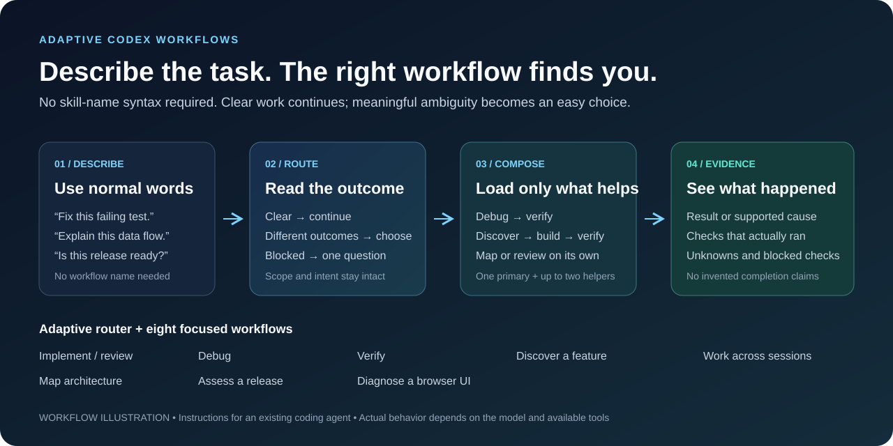
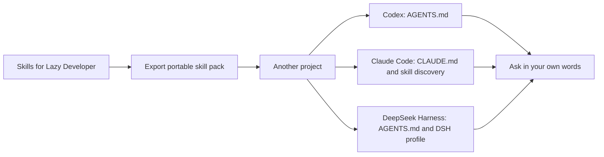
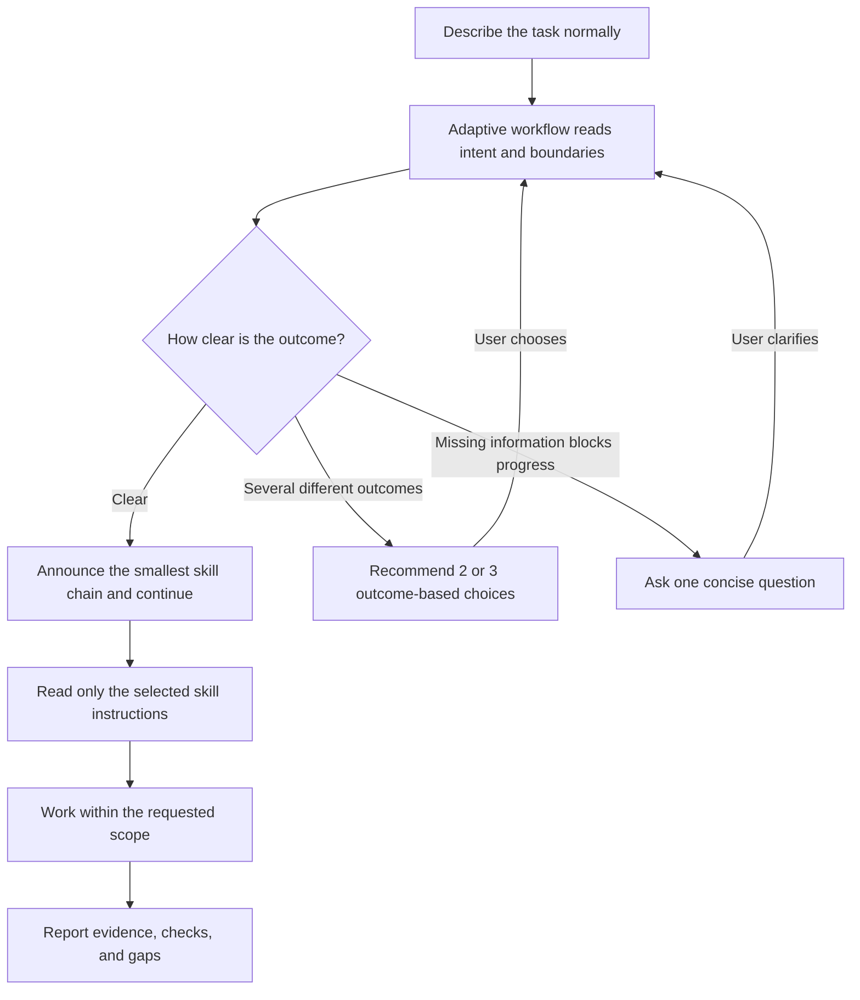

# Skills for Lazy Developer
<!-- Author: Raditte Anggoro | Provenance: RA.CODEXSKILLS.2026.10 | Metadata: docs/provenance.json -->

[](LICENSE)
[](#skills)
[](#development)

**Describe the task. The right workflow finds you.**

An adaptive router and fifteen focused Codex engineering skills for debugging,
implementation, architecture, browser diagnostics, planning, release review, and
evidence-backed verification. Write a normal software request; the router selects one
workflow or a small ordered combination.

**Best for:** developers who want useful workflow guidance without memorizing skill
names or adding one large instruction pack to every coding session.

Each workflow has its own `SKILL.md`. Clear requests continue automatically. When a
request could mean materially different work, the user sees two or three plain-language
outcomes instead of an internal list of skill names.

The companion speaks like an approachable friend helping at the same desk: relaxed,
clear, and comfortable with basic questions or unfinished ideas. It does not pretend
to be human, and it still pushes back when a shortcut could harm security, privacy,
financial correctness, data integrity, or recovery.



*Workflow illustration, not an application screenshot. The skills guide the agent inside your existing development project.*

[Get started](#quick-start) · [Automatic routing](#how-automatic-routing-works) · [Try a task](#try-a-task) · [All workflows](#skills) · [Version 2 plan](docs/V2_DEVELOPMENT_PLAN.md) · [Development](#development) · [License](LICENSE) · [Credits](docs/SOURCES.md)

## Use it in another project or agent

The skills in this repository do not automatically appear in every project or AI
agent. Copy the skill layer into the project you want to use, then follow that host's
instructions. Your existing project files, hooks and credentials are not imported by
the portable pack.



From this repository, create the pack and preview the import before applying it:

```sh
python scripts/package_skill_pack.py export --output dist/skill-pack.zip
python scripts/package_skill_pack.py verify dist/skill-pack.zip
python scripts/package_skill_pack.py import dist/skill-pack.zip --target /path/to/your-project
python scripts/package_skill_pack.py import dist/skill-pack.zip --target /path/to/your-project --apply
```

Replace `/path/to/your-project` with the actual project directory. The import copies
the skill files and `AGENTS.snippet.md`; it does **not** merge instructions into your
project's existing instruction file. Keep the printed backup path for rollback.
See [portable pack guide](docs/PORTABLE_PACK.md) before applying it.

| Agent | Next step in the target project | Verification and limits |
| --- | --- | --- |
| Codex | Merge `AGENTS.snippet.md` into `AGENTS.md`; open the project in Codex. | Local plugin installation was verified with the CLI; desktop UI installation and every model are not guaranteed. [Codex guide](adapters/codex/README.md) |
| Claude Code | Configure Claude's supported skill discovery and add the applicable instructions to `CLAUDE.md`. | Installer and hook contract tested; live Claude session not yet tested. [Claude guide](adapters/claude/README.md) |
| DeepSeek Harness | Use a DSH profile with skill/instruction plugins and install the DSH instruction adapter. | Tested with one DSH profile and model; other DeepSeek clients can have different discovery and hooks. [DSH guide](adapters/dsh/README.md) |

Memory and lifecycle adapters are optional, host-specific setup. Installing the skill
pack alone does not install Engram or enable automatic memory. See the complete
[host adapter guide](docs/ADAPTERS.md) before configuring them.

## Quick start

For Codex plugin installation, the repository includes a compatibility manifest at
`.codex-plugin/plugin.json`. Plugin installation makes the packaged skills available;
the companion instructions in `AGENTS.snippet.md` still need to be merged into the
target project's `AGENTS.md` as described below. Plugin installation from GitHub uses
the committed remote version; local changes are not available there until published.

1. Clone this repository or download its source ZIP.
2. Copy the skill folders you want from `.agents/skills/` into the same location in your project. Copy the whole folder, including `references/` and `agents/` when present.
3. Merge [AGENTS.snippet.md](AGENTS.snippet.md) into your project's existing `AGENTS.md`. If the project has none, create it from the snippet.
4. Open Codex in your project and describe the task normally:

```text
The checkout page becomes blank after a browser refresh. Reproduce the problem,
fix its cause, and verify the original flow.
```

The router should announce a short workflow such as **Browser Diagnostics →
Systematic Debugging → Verification**, then continue. If “improve the checkout page”
could mean a bug fix, a visual change, or a redesign, it should recommend a
plain-language outcome and let the user choose.

The discovery path in the target project must be `.agents/skills/<skill-name>/SKILL.md`. Do not copy this repository as an extra nested folder and expect its skills to apply to the parent project. Codex detects skill changes; restart it if the new skills do not appear. See the [official local-skills documentation](https://learn.chatgpt.com/docs/build-skills).

On macOS, press Command-Shift-period to show the hidden `.agents` folder. Merge existing directories carefully. Same-name skills from different locations do not merge; keep one active copy.

## How automatic routing works

The router uses the request, repository instructions, and skill descriptions. It does
not use a fixed keyword list and it does not treat choosing a workflow as permission
for broader work.



High-confidence routing does not create an extra approval ritual. Diagnosis, review,
and planning requests keep their requested scope: “diagnose only” produces findings,
not an unauthorized fix. The router normally selects one primary skill and no more
than two supporting skills.

## Try a task

Open a scenario below, replace the bracketed input, and paste the prompt into Codex from your project. These are illustrative walkthroughs, not recorded executions or guaranteed results.

<details>
<summary><strong>Fix a failing test</strong> — reproduce → explain → change → verify</summary>

```text
[Failing scenario] now fails with this output: [relevant output].
Reproduce it, find the cause, make the smallest appropriate fix, and check the
original case before handing it back.
```

Look for a reproduction when the environment permits, a cause tied to the affected code, a focused fix and a check of the original case. If a dependency is unavailable, the agent should say which check it could not run.

</details>

<details>
<summary><strong>Understand an unfamiliar app</strong> — input → processing → storage → response</summary>

```text
Trace [endpoint or UI action] through validation, transformations, storage, and the
response. Show a diagram and link the explanation to the relevant source. Do not
edit code.
```

Look for a source-backed flow with unknowns labeled. Static inspection explains the implementation; it should not be presented as a captured runtime trace.

</details>

<details>
<summary><strong>Shape a feature before building it</strong> — inspect → decide → define acceptance</summary>

```text
Plan [feature]. Inspect the current flow, ask only questions that would change the
design, and produce observable acceptance criteria. Planning only.
```

Look for the decisions that affect scope and a small set of testable outcomes. When you are ready to implement, ask for the chosen change explicitly.

</details>

For more prompts, including review, browser diagnosis and resumable work, see [Try the skills in Codex](docs/TRY-IT.md).

## Skills

| Skill | Use it for | What you get |
| --- | --- | --- |
| [adaptive-workflow](.agents/skills/adaptive-workflow/SKILL.md) | Natural-language routing and multi-skill composition | Automatic continuation or a small outcome-based choice |
| [lean-senior-engineering](.agents/skills/lean-senior-engineering/SKILL.md) | Implementation, refactoring, review, audit, technical debt | Small complete changes, focused checks, prioritized findings |
| [systematic-debugging](.agents/skills/systematic-debugging/SKILL.md) | Bugs, failing tests, build failures | Reproduction, supported cause, focused fix when requested |
| [verification-before-completion](.agents/skills/verification-before-completion/SKILL.md) | Implementation handoff, verification requests | Actual check results and clearly stated gaps |
| [feature-discovery](.agents/skills/feature-discovery/SKILL.md) | Ambiguous features, consequential design choices | Decisions and observable acceptance criteria |
| [research-plan-implement](.agents/skills/research-plan-implement/SKILL.md) | Changes across modules or sessions | Code-backed research, execution plan, resumable handoff |
| [architecture-map](.agents/skills/architecture-map/SKILL.md) | Architecture, data processing, change impact | Diagrams connected to real source evidence |
| [release-readiness](.agents/skills/release-readiness/SKILL.md) | Pre-release assessment | Scoped readiness decision, blockers, rollout considerations |
| [browser-diagnostics](.agents/skills/browser-diagnostics/SKILL.md) | UI, console, network, browser performance | Reproduction evidence and an explanation of the failing path |
| [ui-design-intelligence](.agents/skills/ui-design-intelligence/SKILL.md) | UI direction, hierarchy, and enterprise data behavior | A concrete design brief and implementation handoff |
| [ui-implementation](.agents/skills/ui-implementation/SKILL.md) | Agreed responsive interfaces and states | Implemented UI with keyboard and state coverage |
| [ui-quality-verification](.agents/skills/ui-quality-verification/SKILL.md) | Visual, responsive, keyboard, and state audits | Screenshot and interaction evidence with limitations |
| [domain-modeling](.agents/skills/domain-modeling/SKILL.md) | Ambiguous domain terms, states, and invariants | Glossary, lifecycle, events, and invariants |
| [spec-to-code-verification](.agents/skills/spec-to-code-verification/SKILL.md) | Requirement-to-implementation evidence audits | Traceability matrix with pass/fail/partial/untested status |
| [skill-security-guard](.agents/skills/skill-security-guard/SKILL.md) | Pre-adoption review of third-party skills | Injection, permission, exfiltration, and supply-chain findings |
| [transaction-safe-engineering](.agents/skills/transaction-safe-engineering/SKILL.md) | Money, ledger, retry, or batch integrity risk | Idempotency, concurrency, approval, and recovery checks |

Start with a representative task in ordinary language. The router and concise skill
descriptions let Codex select matching workflows automatically. See [natural-language
examples and expected behaviour](docs/TRY-IT.md).

## Design

- Reuse the repository's patterns and dependencies before introducing new ones.
- Route by user outcome and consequence, not a hard-coded keyword count.
- Continue automatically for a clear task; offer choices only when outcomes differ.
- Complete the requested behaviour, including affected callers and meaningful checks.
- Diagnose from evidence and report the scope of verification.
- Keep reviews and diagnosis separate from implementation when the user requests findings only.
- Keep detailed references out of the initial skill context until needed.

The pack contains workflow instructions and optional UI metadata. It does not install hooks, a browser, an MCP server, or an application test framework;
UI fixtures use local Chrome and Playwright tooling when available. Browser diagnostics requires available browser tooling or an existing browser-test setup. Architecture diagrams use available rendering tools and disclose when rendering was not verified.

These workflows are independently maintained files informed by the projects credited in [Sources](docs/SOURCES.md). This is an independent project, with no affiliation with OpenAI or the credited upstream projects. It does not reproduce their full plugins, dashboards, or benchmark results.

## What's in Version 2

Version 2 brings together practical workflows for development, design, and everyday
problem-solving:

- **A friendly companion** that adapts to your request and helps choose a focused workflow.
- **Project memory adapters** for saving and recalling useful context across sessions.
- **UI/UX skills** for design direction, implementation, and quality checks.
- **Engineering skills** for domain modeling, security review, and transaction safety.
- **A portable skill pack** for moving workflows between projects and supported agents.

Explore the [host adapter guide](docs/ADAPTERS.md) and [portable pack guide](docs/PORTABLE_PACK.md)
to choose the setup that fits your project.

## Repository layout

```text
.agents/skills/       Adaptive router, workflow skills, references, and UI metadata
.github/             CI, issue forms, and pull-request template
docs/                Trial prompts, sources, publishing, validation, memory contract
docs/schemas/        Provider-neutral memory record and bundle schemas
adapters/              Per-host instruction/runtime adapters (Codex, DSH)
integrations/           Codex lifecycle runtime and DSH memory bundle
scripts/             Validators, routing evaluation, memory, adapters, bake-off, archive
tests/               Validation, routing, memory, adapter, bake-off, and packaging tests
AGENTS.md            Guidance for maintaining this repository
AGENTS.snippet.md    Guidance to merge into a consuming project
```

Copy the skills and snippet into your application. Keep this repository's maintenance `AGENTS.md`, CI, and tooling in the skills repository.

## Development

Using the skills requires no Python packages. Maintaining this repository requires Python 3.9+ and the development dependency below:

```sh
python3 -m venv .venv
# macOS/Linux:
.venv/bin/python -m pip install -r requirements-dev.txt
.venv/bin/python scripts/validate_skills.py
.venv/bin/python -m unittest discover -s tests -v
.venv/bin/python scripts/build_release.py
```

On Windows, replace `.venv/bin/python` with `.venv\Scripts\python.exe`.

The validator checks metadata, directory/name agreement, natural default prompts,
optional invocation policy, portable references, and local links. Routing tests check
the installed names, chain-size rule, interaction modes, consuming-project policy,
and a natural-language prompt corpus. Memory contract tests check schema alignment,
lifecycle links, privacy rejection, context filtering, and recovery-gate evidence.
Structural checks do not prove that every model will make the same routing decision;
representative model trials are recorded in [validation scope](docs/VALIDATION.md).
Provider bake-off tests require locally supplied provider binaries and are not run by
CI. CI runs the same validation and unit tests on pushes and pull requests.

The archive builder writes a versioned source ZIP and SHA-256 checksum to `dist/`, using an explicit list of distributable paths. It excludes local Git history, virtual environments, working artifacts, and operating-system files.

## Status and contributing

Initial version: **0.1.0**. Read [validation scope](docs/VALIDATION.md), [change history](CHANGELOG.md), and the [contribution guide](CONTRIBUTING.md). Behaviour varies with the model, application, and available tools; report a reproducible example when a workflow misbehaves.

To publish your own copy, follow [Publishing to GitHub](docs/PUBLISHING.md). For vulnerabilities or unintended sensitive-data exposure, see [Security](SECURITY.md).

## License

[MIT](LICENSE), copyright 2026 Raditte Anggoro and contributors. Read the
[project notice](NOTICE.md), [third-party notices](THIRD_PARTY_NOTICES.md), and
[inspiration/source record](docs/SOURCES.md). Credits acknowledge ideas and capability
comparisons; they do not claim affiliation or import upstream code into this project.

The MIT license requires the copyright and permission notice to accompany copies or
substantial portions. The provenance identifier in [NOTICE.md](NOTICE.md), citation
metadata in [CITATION.cff](CITATION.cff), and Git history help identify the original
project; they cannot technically prevent a third party from modifying a copy.
