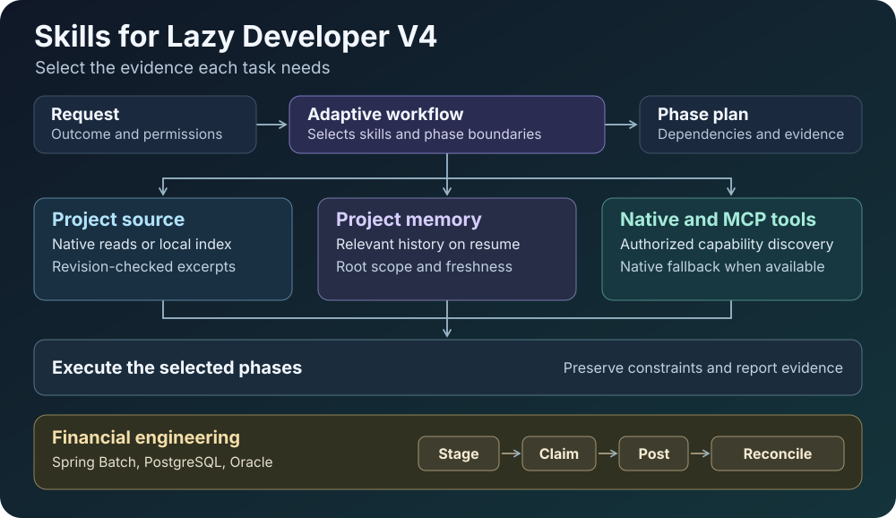
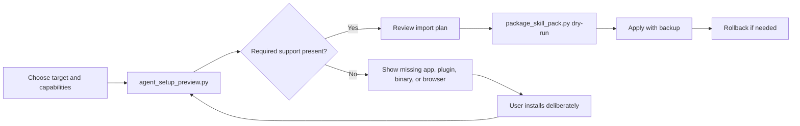
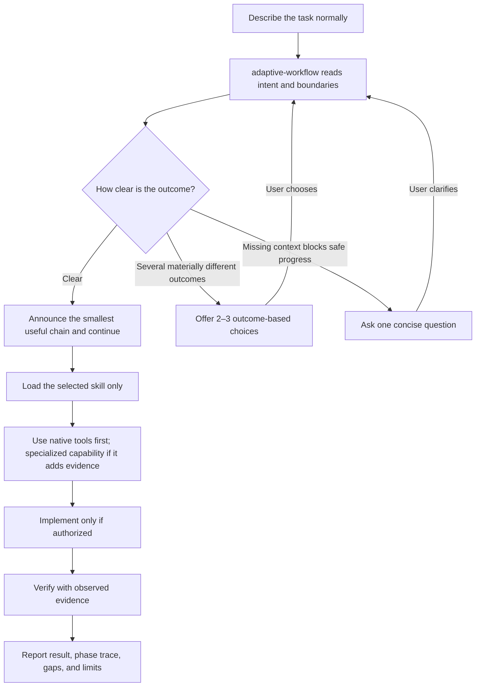
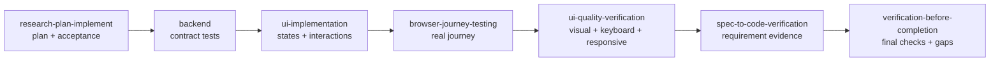
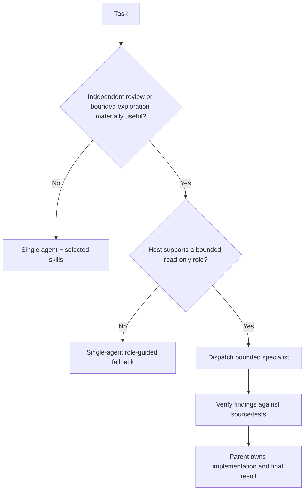
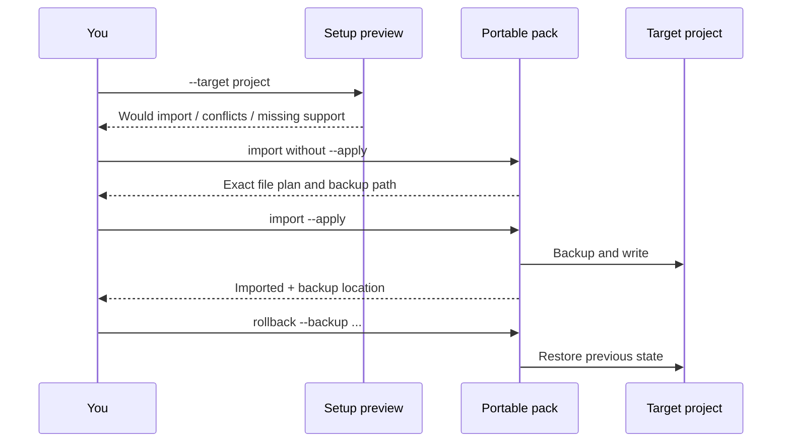

# Skills for Lazy Developer
<!-- Author: Raditte Anggoro | Provenance: RA.CODEXSKILLS.2026.10 | Metadata: docs/provenance.json -->

[](LICENSE)
[](#skills)
[](#development)

**Describe the task. The right workflow finds you.**

17 skills: one adaptive router and sixteen focused workflows for implementation,
debugging, architecture, browser and UI quality, domain modeling, requirements,
security, and transaction safety.

The companion sounds like a sharp friend in a casual Threads conversation: short,
direct, code-switches with you, and uses slang naturally without forcing it. It does not
pretend to be human, and it drops the jokes when a shortcut could hurt security, privacy,
financial correctness, data integrity, or recovery.



*Workflow illustration, not an application screenshot. The pack guides an existing agent;
it is not a standalone app.*

**Jump to:** [At a glance](#at-a-glance) · [Quick start](#quick-start) · [How routing works](#how-routing-works) · [Install preview](#install-preview) · [Skills](#skills) · [Roles](#specialist-roles) · [Repository layout](#repository-layout) · [Development](#development) · [License](#license)

---

## At a glance

| | |
| --- | --- |
| **Skills** | 17: `adaptive-workflow` + 16 focused workflows |
| **Optional specialist roles** | 4 read-only contracts |
| **Host wrappers** | 4 Codex TOML + 4 Claude Markdown |
| **Memory** | Optional Engram adapters; no credentials imported |
| **Packaging** | Portable pack with deterministic manifest, checksum, backup, and rollback |

> **Read this first:** installing the skill pack does **not** install an agent, Engram,
> Chrome, Playwright, plugins, or MCP servers. Use the preview to see what is required for
> the capabilities you choose.

### What is new

- **Specialist roles** — four read-only contracts, rendered deterministically into
  project-scoped Codex and Claude wrappers.
- **Selective delegation** — single-agent stays the default; delegation is bounded and
  has explicit fallback states.
- **Evidence-gated learning** — lessons become local proposals, never automatic edits to
  active skills.
- **Setup preview** — dry-run before import: would import, conflicts, skipped items, and
  missing support.
- **Humanized voice** — casual register and slang when appropriate; formal and precise
  for high-risk work.

---

## Quick start

### 1. Get the repository

```sh
git clone https://github.com/RaditteAnggoro/skill-for-lazy-developer.git
cd skill-for-lazy-developer
```

You can also use the source ZIP, the Codex plugin manifest at
[`.codex-plugin/plugin.json`](.codex-plugin/plugin.json), or the portable pack described
below.

### 2. Preview the target

```sh
python scripts/agent_setup_preview.py --target /path/to/your-project
```

Include optional capabilities to see their requirements:

```sh
python scripts/agent_setup_preview.py \
  --target /path/to/your-project \
  --with-roles --with-memory --with-ui
```

The preview is read-only. It tells you:

- which skills and instructions would be imported;
- which existing skills conflict;
- what is skipped;
- which app, plugin, binary, or browser dependency is missing;
- that credentials, `.env`, API keys, and `Authorization` headers are never imported.

### 3. Import the skill layer

```sh
python scripts/package_skill_pack.py export --output dist/skill-pack.zip
python scripts/package_skill_pack.py verify dist/skill-pack.zip
python scripts/package_skill_pack.py import dist/skill-pack.zip --target /path/to/your-project
```

Review the dry-run. Then apply:

```sh
python scripts/package_skill_pack.py import \
  dist/skill-pack.zip \
  --target /path/to/your-project \
  --apply
```

The import backs up replaced files and prints the backup directory. Optional role
contracts use `--with-roles`:

```sh
python scripts/package_skill_pack.py import \
  dist/skill-pack.zip \
  --target /path/to/your-project \
  --with-roles --apply
```

### 4. Merge the consuming instructions

The pack writes `AGENTS.snippet.md`; it does **not** overwrite your `AGENTS.md`.

- **Codex / DSH:** merge the snippet into `AGENTS.md`.
- **Claude Code:** add the applicable instructions to `CLAUDE.md` and configure the
  host's supported skill/plugin path.
- **Project roles:** render or update project wrappers as described in
  [Specialist roles](#specialist-roles).

### 5. Ask normally

```text
The checkout page becomes blank after a browser refresh. Reproduce it, fix the cause,
and verify the original flow.
```

No skill names, commands, or role names are required. The router selects the smallest
useful chain and continues within the requested scope. More prompts: [Try the skills](docs/TRY-IT.md).

---

## Install preview

The preview is designed for the “what do I still need to install?” moment.



| Capability | Preview flag | Required support | Optional? |
| --- | --- | --- | --- |
| Core skills | none | Python 3.9+, target directory, skill source | No |
| Role contracts | `--with-roles` | Nothing beyond the repository | Yes |
| Project memory | `--with-memory` | Engram binary and target `.engram/config.json` | Yes |
| UI verification | `--with-ui` | Node, Chrome/Chromium, Playwright fixture deps | Yes |
| Codex wrappers | detected | Codex CLI and project `.codex/agents/` | Yes |
| Claude wrappers | detected | Claude Code and project `.claude/agents/` | Yes |

Use `--strict` when a requested capability must fail the preflight if missing:

```sh
python scripts/agent_setup_preview.py --target /path/to/project --with-memory --strict
```

`--json` is available for automation. Full guide:
[Setup preview](docs/SETUP_PREVIEW.md).

---

## How routing works

`adaptive-workflow` is the **single routing authority**. It chooses one primary skill
and at most two supporting skills per phase. It reads only the selected skills and
references.



### Phase orchestration

For substantial work, the agent can plan phases with explicit dependencies and exit
evidence. It loads the next skill at the phase boundary, continues inside the authorized
scope, and closes with a phase table rather than asking after every step.



Simple tasks do not need a phase plan. A phase plan is a contract, not a reason to load
every skill. See the [capability matrix](docs/V2_CAPABILITY_MATRIX.md) for capability boundaries.
and the validator at [`scripts/validate_phase_plan.py`](scripts/validate_phase_plan.py).

### Single-agent first

Delegation is optional and evidence-driven. The default is one agent. Read-only
specialists can help when independent review or context isolation materially improves the
result; they never replace the router, the skill quota, or user scope.



Host support and permissions vary by runtime; use the single-agent fallback when a
bounded role cannot be enforced.

---

## Skills

All 17 skill identities are preserved. The links go to the exact `SKILL.md`.

### Routing and execution

| Skill | Use it for | Output |
| --- | --- | --- |
| [`adaptive-workflow`](.agents/skills/adaptive-workflow/SKILL.md) | Natural-language routing and composition | Small ordered workflow and phase trace |
| [`lean-senior-engineering`](.agents/skills/lean-senior-engineering/SKILL.md) | Implementation, refactoring, review, debt | Small complete change, focused checks |
| [`systematic-debugging`](.agents/skills/systematic-debugging/SKILL.md) | Bugs, failed tests, unexplained behaviour | Reproduction, cause, focused fix |
| [`verification-before-completion`](.agents/skills/verification-before-completion/SKILL.md) | Pre-handoff verification | Observed checks and explicit gaps |
| [`research-plan-implement`](.agents/skills/research-plan-implement/SKILL.md) | Multi-module or multi-session work | Phased plan, implementation, handoff |
| [`feature-discovery`](.agents/skills/feature-discovery/SKILL.md) | Ambiguous or consequential feature choices | Acceptance criteria and scope |
| [`architecture-map`](.agents/skills/architecture-map/SKILL.md) | Architecture, data flow, impact | Source-backed diagrams and anchors |
| [`release-readiness`](.agents/skills/release-readiness/SKILL.md) | Pre-release assessment | Readiness decision, blockers, rollback |

### Browser, UI, and design

| Skill | Use it for | Output |
| --- | --- | --- |
| [`browser-journey-testing`](.agents/skills/browser-journey-testing/SKILL.md) | Real user journeys | Journey evidence and regressions |
| [`browser-diagnostics`](.agents/skills/browser-diagnostics/SKILL.md) | Unexplained browser failures | Console/network/DOM evidence and cause |
| [`ui-design-intelligence`](.agents/skills/ui-design-intelligence/SKILL.md) | UI direction and enterprise data UX | Design brief and implementation handoff |
| [`ui-implementation`](.agents/skills/ui-implementation/SKILL.md) | Agreed responsive UI | Implemented states, keyboard, and data journeys |
| [`ui-quality-verification`](.agents/skills/ui-quality-verification/SKILL.md) | Visual and interaction audit | Screenshots, keyboard, responsive, state findings |

### Domain, evidence, and safety

| Skill | Use it for | Output |
| --- | --- | --- |
| [`domain-modeling`](.agents/skills/domain-modeling/SKILL.md) | Ambiguous terms, states, events, invariants | Glossary, lifecycle, and invariants |
| [`spec-to-code-verification`](.agents/skills/spec-to-code-verification/SKILL.md) | Requirements-to-evidence audit | Traceability matrix with status |
| [`skill-security-guard`](.agents/skills/skill-security-guard/SKILL.md) | Third-party skill review | Injection, permission, and supply-chain findings |
| [`transaction-safe-engineering`](.agents/skills/transaction-safe-engineering/SKILL.md) | Money, ledger, retry, batch integrity | Idempotency, concurrency, approval, recovery |

Each skill is an instruction file plus optional references. References load only when
relevant.

---

## Specialist roles

Four provider-neutral, read-only role contracts live in
[`.agents/roles/`](.agents/roles/). They are **not** skills, a second router, or a
permission sandbox.

| Role | Use when | Output contract |
| --- | --- | --- |
| [`ld-codebase-explorer`](.agents/roles/ld-codebase-explorer.yaml) | Large bounded impact/caller mapping | Source anchors, call paths, unknowns |
| [`ld-independent-test-reviewer`](.agents/roles/ld-independent-test-reviewer.yaml) | A meaningful change needs independent evidence review | PASS/FAIL/BLOCKED/NOT_TESTED per scenario |
| [`ld-financial-integrity-reviewer`](.agents/roles/ld-financial-integrity-reviewer.yaml) | Money, ledger, retry, batch, reconciliation | Invariants, failure scenarios, required tests |
| [`ld-workflow-tool-evaluator`](.agents/roles/ld-workflow-tool-evaluator.yaml) | Measured routing/tool comparison | Baseline, candidate, metrics, limits |

```sh
python scripts/validate_roles.py
python scripts/render_agent_adapters.py --host codex --check
python scripts/render_agent_adapters.py --host claude --check
```

Generated project wrappers:

- [`Codex TOML`](.codex/agents/) — name, description, developer instructions; no model,
  sandbox mode, or user-home values.
- [`Claude Markdown`](.claude/agents/) — read-only `Read, Grep, Glob` only.

`write_permission: false` is policy metadata, not runtime enforcement. If the host cannot
enforce read-only behavior, do not dispatch the role; use the main-agent fallback.
Roles are opt-in in the portable pack (`--with-roles`).

---

## Install in another agent

| Host | Discovery | Instructions | Optional extras |
| --- | --- | --- | --- |
| **Codex** | `.agents/skills/` | Merge `AGENTS.snippet.md` into `AGENTS.md` | `.codex/agents/`, Codex hooks |
| **Claude Code** | Host skill/plugin path | Add applicable instructions to `CLAUDE.md` | `.claude/agents/`, hooks |
| **DeepSeek Harness** | `.agents/skills/` | `AGENTS.md` or project instructions | DSH profile, memory bundle |
| **Plain repo** | Files are portable Markdown | Read `SKILL.md` selectively | No runtime required |

### Import flow



Optional memory setup is host-specific. Installing skills does not install Engram.
See [Adapting to hosts](docs/ADAPTERS.md), [Portable pack](docs/PORTABLE_PACK.md), and
[Setup preview](docs/SETUP_PREVIEW.md).

<details>
<summary><strong>What the preview never imports</strong></summary>

- credentials, `.env`, API keys, OAuth tokens, or `Authorization` headers;
- another project's memory database or local Engram data;
- user-home hooks or global agent settings;
- browser profiles, cookies, or session data;
- package-manager lockfiles from a consuming project.

The preview reports secrets as excluded; the importer does not copy them.

</details>

---

## Repository layout

This tree shows the major source paths; generated `dist/`, local state (`.venv/`,
`.engram/`, `.serena/`), and private working evidence are intentionally not shown.

```text
.
├── .agents/
│   ├── plugins/marketplace.json      # plugin marketplace metadata
│   ├── roles/                        # 4 read-only role contracts + schema
│   │   ├── schema.yaml
│   │   ├── ld-codebase-explorer.yaml
│   │   ├── ld-independent-test-reviewer.yaml
│   │   ├── ld-financial-integrity-reviewer.yaml
│   │   └── ld-workflow-tool-evaluator.yaml
│   └── skills/                       # 17 skill directories
│       ├── adaptive-workflow/
│       │   └── references/           # tool, delegation, learning, voice policies
│       ├── architecture-map/
│       ├── browser-diagnostics/
│       ├── browser-journey-testing/
│       ├── domain-modeling/
│       ├── feature-discovery/
│       ├── lean-senior-engineering/
│       ├── release-readiness/
│       ├── research-plan-implement/
│       ├── skill-security-guard/
│       ├── spec-to-code-verification/
│       ├── systematic-debugging/
│       ├── transaction-safe-engineering/
│       ├── ui-design-intelligence/
│       ├── ui-implementation/
│       ├── ui-quality-verification/
│       └── verification-before-completion/
├── .claude/agents/                   # 4 generated read-only Markdown wrappers
├── .codex/agents/                    # 4 generated Codex TOML wrappers
├── .codex-plugin/plugin.json         # Codex plugin compatibility manifest
├── .github/                          # CI, issue forms, PR template
├── adapters/
│   ├── codex/                        # Codex lifecycle/role setup
│   ├── claude/                       # Claude lifecycle/role setup
│   ├── dsh/                          # DSH instruction adapter + fallback
│   └── portable/                     # host-neutral pack usage
├── integrations/
│   ├── codex/memory_runtime.py       # lifecycle memory runtime
│   └── dsh/companion-memory/         # DSH Host plugin + memory bundle
├── docs/
│   ├── assets/                       # workflow illustration
│   ├── schemas/                      # memory, enhancement, learning schemas
│   ├── ADAPTERS.md                   # host compatibility matrix
│   ├── AGENT_ROLE_ARCHITECTURE.md    # roles, fallback, host limits
│   ├── LEARNING_AND_EVALUATION.md   # proposal/evaluation policy
│   ├── PORTABLE_PACK.md              # export/import/backup/rollback
│   ├── SETUP_PREVIEW.md              # install preflight
│   ├── SOURCES.md                    # attribution
│   └── V2_*                          # memory, capability, phase records
├── scripts/
│   ├── agent_setup_preview.py        # read-only install/support preview
│   ├── package_skill_pack.py         # export/verify/import/rollback
│   ├── validate_skills.py            # skill metadata and link checks
│   ├── validate_roles.py             # strict role contract checks
│   ├── render_agent_adapters.py      # deterministic host wrappers
│   ├── propose_skill_learning.py     # local proposal staging
│   ├── evaluate_phase1_enhancements.py
│   ├── evaluate_delegation.py
│   ├── validate_phase_plan.py
│   ├── build_release.py              # deterministic archive
│   └── ...                           # memory, routing, benchmark, adapter scripts
├── tests/
│   ├── fixtures/                     # security/spec/domain/transaction fixtures
│   ├── roles/                        # invalid role fixture
│   ├── ui/                           # plain/React/Next fixture checks
│   ├── hermes_*                      # enhancement/spec matrices
│   └── test_*.py
├── AGENTS.md                         # maintainer instructions
├── AGENTS.snippet.md                 # consuming-project instructions
├── README.md
├── CHANGELOG.md
├── SECURITY.md
├── CONTRIBUTING.md
├── THIRD_PARTY_NOTICES.md
├── LICENSE
├── NOTICE.md
├── CITATION.cff
├── requirements-dev.txt
└── VERSION
```

### What goes where

- **`.agents/skills/`** — the portable instruction layer; no daemon and no hidden runtime.
- **`.agents/roles/`** — advisory contracts; not skills and not automatically installed.
- **`.codex/agents/` and `.claude/agents/`** — project-scoped generated wrappers.
- **`adapters/`** — host-specific setup and lifecycle docs.
- **`integrations/`** — optional memory runtimes; never imported by the skill pack.
- **`docs/`** — setup, licensing, design, and project records.
- **`scripts/`** — validators, previews, renderers, packagers, and benchmarks.
- **`tests/`** — deterministic verification and synthetic fixtures.

---

## Development

Using the skills requires no Python packages. Maintaining this repository requires
Python 3.9+ and the development requirements.

```sh
python3 -m venv .venv
# macOS/Linux
.venv/bin/python -m pip install -r requirements-dev.txt

# validate source and contracts
.venv/bin/python scripts/validate_skills.py
.venv/bin/python scripts/validate_roles.py
.venv/bin/python scripts/render_agent_adapters.py --host codex --check
.venv/bin/python scripts/render_agent_adapters.py --host claude --check
.venv/bin/python scripts/validate_phase_plan.py

# deterministic gates
.venv/bin/python scripts/evaluate_phase1_enhancements.py
.venv/bin/python scripts/evaluate_delegation.py

# build the deterministic archive
.venv/bin/python scripts/build_release.py
```

On Windows use `.venv\Scripts\python.exe`.

### Preview the installer

```sh
.venv/bin/python scripts/agent_setup_preview.py --target /tmp/project --with-roles
.venv/bin/python scripts/package_skill_pack.py export --output dist/skill-pack.zip
.venv/bin/python scripts/package_skill_pack.py verify dist/skill-pack.zip
```

The release archive is generated at `dist/codex-developer-skills-0.1.0.zip`; it is
ignored by Git and should be attached to a release separately.

---

## Voice

The companion mirrors the user's register. Casual Indonesian can use `aku`, `kita`,
`nih`, `sih`, `ya`, `kan`, `deh`, and light slang; English can use contractions and
sparing casual phrases. It should not force slang, imitate emotions, claim to be human,
or open with corporate boilerplate. Formal users get formal language. Safety, financial,
security, and data-integrity warnings drop the jokes and stay precise.

See [voice-and-humanizer examples](.agents/skills/adaptive-workflow/references/voice-and-humanizer.md).

---

## Design principles

- Reuse the repository's patterns and dependencies before introducing new ones.
- Route by outcome and consequence, not a keyword count.
- Continue automatically for clear, authorized work; ask only when the answer changes the
  safe result.
- Keep diagnosis, review, planning, and implementation boundaries intact.
- Verify with observed evidence; label blocked and unverified checks.
- Keep detailed references out of the initial context until needed.
- Prefer one agent; delegate only when independent evidence justifies it.
- Never auto-install external systems, modify user-global settings, or auto-promote a
  skill lesson.

The pack contains workflow instructions and optional metadata. It does not install hooks,
a browser, an MCP server, an application test framework, or a model provider. Browser
examples require an available browser or project automation; otherwise the check is
reported as blocked.

---

## Troubleshooting

<details>
<summary><strong>The target does not see the skills</strong></summary>

Check that the target has `.agents/skills/<name>/SKILL.md`; do not nest this repository
inside another folder and expect the parent project to discover it. Codex may detect
changes automatically, but restart if needed. Claude uses its own skill/plugin discovery
path; follow [Claude setup](adapters/claude/README.md).

</details>

<details>
<summary><strong>The import says a skill conflicts</strong></summary>

The real import backs up the existing skill before replacing it. Use the dry-run output
to review conflicts; keep a backup path for rollback. Do not force-overwrite a custom
skill you have not reviewed.

</details>

<details>
<summary><strong>Memory does not work</strong></summary>

Memory is optional. Run the preview with `--with-memory`; ensure Engram is installed and
the target has `.engram/config.json`. Installing the skill pack alone does not install
Engram or enable lifecycle hooks. Review the host adapter before trusting hooks.

</details>

<details>
<summary><strong>A role is not dispatched</strong></summary>

A Markdown or TOML wrapper is not a runtime sandbox or a guarantee that the host exposes
subagents. Check the host status and actual permissions. If dispatch is unavailable or
restrictions cannot be enforced, continue with the single-agent fallback.

</details>

---

## Contributing

Read [CONTRIBUTING.md](CONTRIBUTING.md) and [AGENTS.md](AGENTS.md). For a workflow
change, follow the contribution guide and run the relevant repository checks. Do not add
a skill just to increase the count; extend an existing owner when it is the same
responsibility.

For vulnerabilities or sensitive-data exposure, follow [SECURITY.md](SECURITY.md). To publish your own copy, follow [Publishing to GitHub](docs/PUBLISHING.md).

---

## License

[MIT](LICENSE), copyright 2026 Raditte Anggoro and contributors. See
[NOTICE.md](NOTICE.md), [THIRD_PARTY_NOTICES.md](THIRD_PARTY_NOTICES.md), and
[Sources](docs/SOURCES.md). The project credits ideas and capability comparisons; it does
not claim affiliation with OpenAI, Anthropic, Nous Research, or any upstream project.
