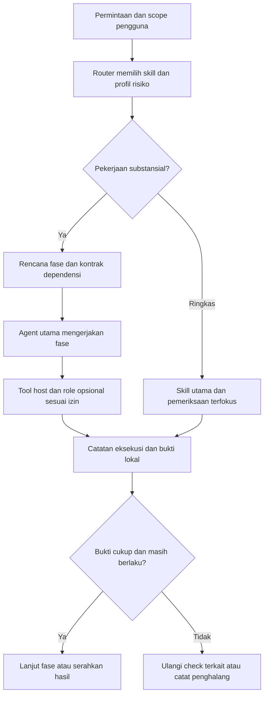

# Rencana pengembangan lanjutan Skills for Lazy Developer

Audit 19 November 2026 · Basis `2c76486ce0103d409a215aa26e0ac5e06d9a68c7` · Versi repo `0.1.0` · Usulan pengembangan

Pertahankan **17 skill dan empat kontrak role** untuk gelombang pertama. Investasi terbesar sebaiknya masuk ke tiga hal yang langsung terasa di proyek konsumen: UI yang sesuai dengan alur kerja pengguna, verifikasi yang menangkap kegagalan nyata, dan pekerjaan panjang yang bisa dilanjutkan dengan bukti yang masih berlaku. Model terbaru membantu mengambil keputusan, tetapi ketiga hasil itu memerlukan kontrak, fixture, dan pemeriksaan yang independen dari jawaban model.

Urutan kerja yang direkomendasikan adalah memperbaiki pemeriksaan yang bisa memberi hasil hijau keliru, membuktikan satu alur dari brief sampai verifikasi, lalu memperluas pola yang sudah berhasil ke host dan kasus lainnya. Pack inti tetap ringan. Pemeriksaan browser, model, role, dan memori yang lebih mendalam menjadi kemampuan opsional sesuai kebutuhan proyek.

## 1. Kondisi proyek sekarang

Repository sudah memiliki router natural-language, pembagian fase, pemilihan tool berdasarkan kemampuan, lima workflow UI/browser dengan tanggung jawab berbeda, empat role read-only, adapter host, portable pack, dan proposal pembelajaran lokal. Perubahan Hermes menambah exploratory QA, TDD berbasis risiko, diagnostic lintas lapisan, kontrak spike, dan pemeriksaan bukti. Sebagian telah diuji sebagai kontrak atau simulasi, dan cakupan yang diobservasi berbeda per host. [Laporan Hermes](HERMES_IMPLEMENTATION_REPORT.md) · [Cakupan validasi](VALIDATION.md)

| Temuan pada basis audit | Dampak | Prioritas dan arah |
| --- | --- | --- |
| Pemeriksaan bulk approval plain/React menerima teks `1 selected` saat pesan sukses tidak ditemukan. Kedua runner otomatis menyimpan dan menerima baseline screenshot yang hilang. | Approval yang tidak mengubah keadaan atau screenshot yang belum ditinjau dapat lolos. | P0. Tegaskan hasil pada ID yang dituju dan jadikan pembaruan snapshot tindakan eksplisit. [Plain/React](../tests/ui/run_ui_checks.mjs#L132) · [Snapshot plain/React](../tests/ui/run_ui_checks.mjs#L58) · [Snapshot Next](../tests/ui/run_next_checks.mjs#L23) |
| Kedua runner menunjuk Chrome macOS. Mobile mengecek jumlah baris DOM dan keyboard terutama menghitung stop. Runner Next tidak memeriksa bulk approval dan error browser setara. CI utama menjalankan validasi Python dan packaging. | Suite lokal belum menjadi gate browser lintas lingkungan. Checkout versi baru belum otomatis punya bukti journey. | P0. Jalankan satu profil browser yang bisa direproduksi, periksa perilaku, dan tambah gate khusus UI. [Runner plain/React](../tests/ui/run_ui_checks.mjs) · [Runner Next](../tests/ui/run_next_checks.mjs) · [CI](../.github/workflows/validate.yml) |
| Validator fase memeriksa urutan, skill, dependensi dan string bukti. Simulator menyalin bukti yang direncanakan dan selalu menghasilkan fase `completed`. | Output simulator menunjukkan bentuk laporan. Status selesai dan kesiapan fase berikutnya perlu bukti dari eksekusi yang aktual. | P1. Tambah catatan eksekusi terpisah dari rencana dan periksa keterkinian bukti sebelum melanjutkan. [Validator](../scripts/validate_phase_plan.py#L34) · [Simulator](../scripts/simulate_phase_orchestration.py#L21) |
| Pemeriksaan handoff memadankan pola sukses pada pesan akhir dan pola perintah pada transkrip. Ia belum mengaitkan keduanya dengan exit status dari pemanggilan yang sama. Recall mengambil bagian akhir teks provider. | Memori lama bisa mendapat tingkat kepercayaan berlebih dan menyampaikan klaim yang sulit ditelusuri. | P0. Perbaiki promosi handoff dan gunakan filter record terstruktur pada recall. [Runtime Codex](../integrations/codex/memory_runtime.py#L269) · [Recall](../integrations/codex/memory_runtime.py#L109) · [Kontrak memori](../scripts/memory_contract.py) |
| Evaluasi delegasi memakai fixture. Rekaman host menyebut wrapper Codex/Claude bisa diparse, dengan dispatch Codex `NOT_RUN`, Claude `AUTH_REQUIRED`, dan adapter DSH `UNSUPPORTED` pada pengujian yang dicatat. | File role yang valid belum menunjukkan bahwa host menjalankan role tersebut dengan izin yang diharapkan. | P2. Buktikan satu dispatch pada host yang mendukungnya dengan fixture lokal. [Evaluator](../scripts/evaluate_delegation.py) · [Status historis](../tests/host_integration_status.yaml) |
| Hasil v3 berasal dari beberapa snapshot dan lingkup berbeda. Comparator routing menghitung pasangan yang bisa dinilai dan dapat menghasilkan laporan dengan nol pasangan yang bisa dibandingkan. | Satu angka agregat mudah menyembunyikan ketimpangan kasus terblokir atau hasil terlalu sempit. | P1. Tambah cakupan per skenario, denominator eksplisit, dan keputusan `insufficient_evidence` bila data kurang. [Baseline v3](ENHANCEMENT_BASELINE.md) · [Comparator](../scripts/compare_enhancement_results.py#L22) |
| Pemeriksa spesifikasi mencari ID di implementasi dan teks test. Pemeriksa transaksi memvalidasi deklarasi, sementara runner repayment mengevaluasi fixture SQLite sintetis. | Referensi ada belum membuktikan assertion berjalan. Fixture sempit belum menilai crash, persaingan worker, atau rekonsiliasi lintas layanan. | P2. Bedakan keterlacakan sumber, assertion yang relevan dan hasil eksekusi. Tambah skenario transaksi dengan oracle independen. [Traceability](../scripts/verify_spec_traceability.py) · [Transaction checker](../scripts/check_transaction_safety.py) · [Repayment trial](../scripts/run_repayment_trial.py) |
| Builder ZIP merambah direktori yang diizinkan dari filesystem dengan daftar pengecualian. | File lokal tak terlacak di direktori publikasi dapat ikut ketika arsip dibangun dari working tree. | P0. Publikasikan dari snapshot bersih dan manifest yang terikat pada commit. [Builder arsip](../scripts/build_release.py#L11) · [Portable pack](PORTABLE_PACK.md) |
| Dua ekspor portable pack dari input yang sama menghasilkan digest ZIP berbeda pada uji lokal. Konten manifest identik, timestamp entri manifest berbeda. Import menulis manifest rollback setelah menulis file target. | Arsip belum byte-identical lintas waktu build. Import yang terputus sebelum manifest tercatat membutuhkan jalur pemulihan yang lebih baik. | P0. Tetapkan metadata ZIP yang stabil, samakan rencana preview dan apply, dan simpan jurnal pemulihan sebelum penulisan. [Eksportir](../scripts/package_skill_pack.py#L80) · [Import](../scripts/package_skill_pack.py#L134) |

Pada snapshot audit, validator mengonfirmasi 17 skill, empat phase plan, empat role, serta wrapper Codex dan Claude yang deterministik. Semua 258 unit test lulus. Uji ekspor portable dilakukan dua kali di direktori sementara. Bukti browser dan eksekusi model pada dokumentasi sebelumnya tetap terikat pada snapshot dan lingkup masing-masing. Temuan browser berasal dari inspeksi kode. Browser suite, dispatch wrapper, dan A/B model kandidat tidak dijalankan pada snapshot ini.

## Status implementasi P0 — 2026-11-19

Audit di atas tetap menjadi catatan basis. Perbaikan P0 yang sudah diterapkan:

- **P0a — browser:** bulk approval memakai pesan sukses eksplisit, perubahan state baris,
  dan pembersihan selection; baseline screenshot yang hilang menjadi failure dan update
  baseline hanya lewat `--update-snapshots`; executable browser dapat dikonfigurasi;
  Next memeriksa bulk approval dan error state; CI UI structural ditambahkan.
- **P0b — trust memori:** handoff hanya menjadi `verified` jika command dan exit sukses
  terhubung pada invocation transcript yang sama; recall memilih record envelope aktif
  secara utuh dan tidak memotong suffix record secara sembarang.
- **P0c — distribusi:** manifest portable memakai metadata ZIP stabil; import menulis
  recovery journal sebelum perubahan file dan rollback memahami journal `prepared`;
  builder menerima `--require-clean` untuk snapshot publikasi.

P1a/P1b/P2/P3 tetap pekerjaan lanjutan; lihat tabel urutan di bawah. Bukti P0 ada di
`tests/test_codex_adapter.py`, `tests/test_phase7.py`, `tests/ui/run_ui_checks.mjs`,
`tests/ui/run_next_checks.mjs`, dan workflow `.github/workflows/ui.yml`.

## Aturan eksekusi one-shot

Jika scope dan authorization sudah jelas, agent menyelesaikan task dalam satu pass:
rencana, implementasi, verifikasi, dan laporan tanpa meminta persetujuan rutin di antara
langkah. Agent hanya bertanya jika keputusan yang hilang, credential, izin, dependency
eksternal, atau outcome yang benar-benar berbeda menghalangi kemajuan aman. Asumsi aman
yang diperlukan harus dinyatakan dan pekerjaan dilanjutkan. One-shot tidak berarti
mengabaikan blocker nyata atau memperluas scope. Detail perilaku ada di
[`adaptive-workflow`](../.agents/skills/adaptive-workflow/SKILL.md) dan
[`AGENTS.snippet.md`](../AGENTS.snippet.md).

## 2. Arsitektur yang dituju

**Profil proporsional.** Perubahan teks atau fix kecil memakai satu skill utama dan pemeriksaan terfokus. Pekerjaan lintas modul memakai fase yang beralasan. Perubahan pada data, otorisasi, pembayaran, migrasi, atau perjalanan pengguna utama memakai pemeriksaan konsekuensi dan recovery yang spesifik. Aturan satu primary dan maksimum dua support per fase tetap berlaku. Sprint pertama memakai satu agent sebagai penanggung jawab, dengan role pembaca hanya ketika pertanyaan independen bernilai untuk keputusan.

**Pisahkan rencana, penyelesaian, dan bukti.** Pertahankan format lama dan simulator untuk kompatibilitas. Mulai dari schema versi baru atau ekstensi berversi untuk satu use case. Tambahkan CLI lokal opsional yang mengimpor catatan dan menjawab `status` serta `next`. Validator memeriksa data dan memberitahukan fase berikut. Agent host memilih dan menjalankan tindakan sesuai izin. Pembatasan teknis berlaku pada pemeriksaan yang melewati CLI itu. Perluas menjadi penegakan di adapter hanya bila pilot menunjukkan manfaat dan host menyediakan mekanisme yang bisa divalidasi.

| Record usulan | Isi minimum | Aturan |
| --- | --- | --- |
| Rencana | Tujuan, scope, ID fase dan requirement, skill, dependensi, kontrak, jenis bukti wajib | Scope berasal dari instruksi yang berwenang. Catat perubahan kontrak. Hasil tool dan role tidak memperluas scope. |
| Catatan eksekusi | `run_id`, fase, `event_id`, status, waktu, revision, fingerprint input terkait, sumber observasi | Dapat diputar ulang tanpa mengulang efek. Identitas ganda ditolak atau ditangani secara idempoten. Bukti palsu atau perubahan file di luar cakupan menjadi temuan. |
| Bukti | `check_id`, `requirement_id`, target, sumber observasi, metode, hasil, referensi artefak lokal, digest konten jika tersedia | Bukti dijaga di dalam direktori run yang disetujui. Penulisannya atomik. Referensi yang hilang atau tidak cocok membuat klaim terkait belum terverifikasi. |
| Kapabilitas | Kemampuan, host dan versi, status discovery, batas izin, hasil pemanggilan dan fallback | `unknown`, `available`, `auth_required`, `unsupported`, `failed` dilaporkan sesuai observasi. Nama tool di dokumentasi hanya petunjuk discovery. |

Gunakan tipe bukti yang jelas: inspeksi sumber, simulasi, eksekusi fixture, observasi host langsung, atau review manusia. Simpan hasil `passed`, `failed`, `blocked`, `not_run`, dan `not_applicable` secara terpisah. Fase bergantung pada bukti `passed` yang relevan. Perubahan pada input yang diklaim oleh sebuah check menandai bukti itu `stale` dan menahan hanya fase yang terdampak. Tes penerimaan wajib mencakup proses berhenti di tengah fase, bukti yang hilang, digest berubah, replay, dan hasil terblokir tanpa klaim selesai. [Kontrak fase yang tersedia](../.agents/skills/research-plan-implement/SKILL.md)

## 3. Jalur pengembangan UI dan browser

Untuk perubahan UI substansial, mulai dari satu brief yang bisa diuji. Isinya peran pengguna, tugas utama, istilah produk, aksi prioritas, komponen serta token yang sudah dipakai, hal yang dipertahankan, dan keadaan yang perlu ditangani. Petakan satu ID skenario dari brief sampai pemeriksaan. Misalnya `APPROVAL-01` mencatat operator memilih satu dokumen, meninjau nominal dan identitas, mengonfirmasi, lalu melihat status dokumen itu berubah sementara dokumen lain tetap sama.

1. **Desain.** Gunakan alur dan komponen produk yang sudah ada. Kaitkan heading, badge, kartu ringkasan, dan copy dengan keputusan atau tindakan pengguna. Gabungkan informasi berulang dan buat satu aksi utama per konteks. Uji apakah pengguna bisa menemukan langkah berikutnya tanpa penjelasan dari pembuat UI.
2. **Implementasi.** Petakan komponen, interaksi, serta status pending, empty, error, retry, selesai, dan akses ditolak yang berlaku. Untuk tabel padat, ukur apakah entitas, nominal dan status bisa dibandingkan serta dibaca di ukuran target. Pertahankan konteks dan input pengguna yang masih sah saat gagal.
3. **Journey.** Pakai browser nyata dengan fixture sintetis atau lingkungan development yang diizinkan. Periksa outcome bisnis yang dapat diobservasi, bukan hanya tombol yang dapat diklik. Fixture in-memory memeriksa transisi state. Untuk klaim yang bertahan setelah refresh, gunakan fixture yang benar-benar punya penyimpanan. Uji cancel, gagal dan recovery sesuai konsekuensi.
4. **Audit kualitas.** Gunakan bukti dari sesi journey yang sama dan tambahkan check yang belum ada. Uji urutan fokus, aktivasi keyboard, pemulihan fokus, label dan status yang diumumkan, kontras, reflow dan zoom, serta keterbacaan teks panjang. Rujuk kriteria WCAG 2.2 yang relevan dan beri hasil per check. Bagi jalur yang membutuhkan pembaca layar, rencanakan pemeriksaan manual. [WCAG 2.2](https://www.w3.org/TR/WCAG22/)
5. **Diagnosis.** Pakai `browser-diagnostics` ketika penyebab perilaku belum jelas. Ambil DOM, error halaman, dan request terkait pada jalur gagal. Gunakan browser kedua hanya bila menambah bukti yang berbeda, misalnya masalah rendering khusus engine.

**Pilot test harness.** Pin browser, OS/profile, font, bahasa, timezone dan ukuran viewport bagi screenshot yang menjadi gate. Pakai kondisi tunggu berdasarkan elemen atau state yang diharapkan. Rekam browser error, request gagal dan respons relevan dengan allowlist yang spesifik. Tetapkan deadline startup dan cleanup proses. Update baseline hanya lewat perintah eksplisit serta diff yang ditinjau. Buktikan bahwa approval no-op dan snapshot hilang memberi status gagal. Tambahkan ID yang dipilih, hasil setelah konfirmasi, serta keadaan baris lain sebagai assertion.

**Perluasan bertahap.** Mulai dari approval, form yang gagal dan bisa dipulihkan, serta tabel pencarian/filter. Setelah stabil, perluas menjadi minimal delapan skenario yang berbeda, termasuk rekonsiliasi, navigasi sempit, pembatasan akses, draft, dan laporan. Pilih ukuran sempit/sedang/lebar, misalnya 360/768/1440, sesuai produk. Uji partial failure, jaringan lambat, long labels dan teks Indonesia/Inggris sesuai risiko. Gunakan browser runner yang sama untuk fixture dan proyek konsumen apabila kewenangan dan targetnya sesuai. [Panduan fixture UI](../tests/ui/README.md) · [Bukti historis](../tests/ui/evidence.yaml)

**Cara menilai hasil yang terasa berlebihan atau generik.** Minta dua penilai mencoba tugas pada baseline dan kandidat tanpa tahu labelnya. Nilai keberhasilan tugas, kemampuan menemukan aksi utama, jumlah salah tindakan, keterbacaan informasi, copy berulang, dan kesesuaian dengan sistem desain. Catat bukti per kriteria dan selesaikan perbedaan penilaian dengan melihat rekaman journey. Screenshot diff membantu menemukan perubahan visual. Keputusan kualitas menggabungkan perilaku, accessibility, dan review produk. Aksi kritis yang gagal, data salah atau fokus yang memblokir tugas menahan kelulusan jalur itu.

## 4. Backend, arsitektur, keamanan dan release

| Area | Perubahan prioritas | Syarat penerimaan |
| --- | --- | --- |
| Review dan debugging | Mulai dari reproduksi dan hipotesis yang bisa digugurkan. Gunakan test dekat perubahan, kontrak API, atau integrasi minimal sesuai jangkauan. Rekam gejala, kondisi penentu, dan regresi. | Fixture dengan penyebab berbeda tidak dianggap berhasil karena teks diagnosis serupa. Perubahan sederhana tetap selesai tanpa suite yang tak relevan. |
| Arsitektur dan dampak | Tautkan `file + symbol + edge`, jenis bukti, dan batas cakupan. Gunakan pencarian native dulu. Indeks dipertimbangkan jika analisis berulang sulit dan ada ground truth terkontrol. | Minimal satu dependency statis, call tidak langsung, background job, serta hubungan source–SQL dinilai pada fixture yang sesuai. Edge dinamis yang belum dipastikan tetap berlabel belum terverifikasi. |
| Domain dan transaksi | Tempelkan invariant pada state transition dan aturan pihak yang berwenang. Jalankan duplicate delivery, retry, tabrakan dua worker, serta crash sebelum/sesudah commit pada fixture sekali pakai dan external payment stub. | Tidak ada double effect. Key dan payload yang sama dapat direplay. Benturan key dengan payload berbeda ditangani eksplisit. Balancing per mata uang, state rollback, rekonsiliasi, dan audit trail dibuktikan dengan assertion independen. |
| Spesifikasi | Hubungkan requirement → assertion → hasil run. Pertahankan pencarian ID sebagai lint awal. Tandai requirement yang baru punya anchor sumber tanpa check eksekusi. | Fixture marker-only gagal memenuhi requirement yang mensyaratkan bukti runtime. Satu check boleh melayani lebih dari satu requirement bila assertion relevan untuk masing-masing. |
| Keamanan skill dan tool | Perluas pemeriksaan defensif terhadap provenance, lisensi, dependensi, izin, data egress, symlink, file yang tidak terbaca, dan redaksi keluaran. Tinjau perubahan izin saat versi pihak ketiga berubah. | Hasil scan membedakan temuan, area tak teramati, dan hasil review. Proses review tidak mengeksekusi paket. Provider baru memerlukan use case, versi yang dipin, dan fallback. |
| Distribusi dan release | Pisahkan source ZIP dari pack konsumen. Bangun arsip rilis dari snapshot bersih, stabilkan metadata manifest, dan cocokkan isi dengan daftar publikasi. Gunakan rencana file yang sama untuk preview dan apply serta jurnal pemulihan untuk operasi yang terputus. | Dua build dari input identik pada waktu berbeda menghasilkan digest identik. File lokal privat dan output run dikecualikan. Uji pemulihan saat apply terputus dan penanganan konflik jika file berubah setelah impor. |

Sumber awal: [domain modeling](../.agents/skills/domain-modeling/SKILL.md) · [transaction safety](../.agents/skills/transaction-safe-engineering/SKILL.md) · [review keamanan skill](../.agents/skills/skill-security-guard/SKILL.md) · [release readiness](../.agents/skills/release-readiness/SKILL.md).

## 5. MCP, role, memori dan pembelajaran

- **Adaptive MCP.** Pilih tool setelah scope dan skill ditentukan. Verifikasi kemampuan dan izin yang benar-benar ada, seperti browser, penelusuran simbol, dokumentasi, atau database hanya-baca. Untuk operasi jarak jauh gunakan target yang telah diotorisasi. Rekam hanya identitas capability, target yang boleh dicatat, outcome, dan bukti yang dibutuhkan. Ketika tool gagal, pilih fallback yang mampu menjawab pertanyaan yang sama. Bukti yang tak dapat diperoleh tetap `blocked` atau `not_run` sesuai keadaan. [Panduan pemilihan tool](../.agents/skills/adaptive-workflow/references/tool-selection.md)
- **Role dan host.** Pertahankan role saat ini sebagai pemeriksa lingkup terbatas. Parent mengirim pertanyaan, batas file, dan keluaran yang diperlukan. Parent mengecek kembali klaim yang berpengaruh. Pilot Codex menguji dispatch terhadap fixture sintetis, identitas role, batas read-only, timeout, cancel, dan kelanjutan parent saat role gagal. Host tanpa dukungan memakai rubrik skill yang sama lewat satu agent. Sebelum menyatakan kemampuan, bedakan wrapper yang dibuat, wrapper yang diparse, role yang teramati jalan, dan pembatasan host yang sudah diuji. [Arsitektur role](AGENT_ROLE_ARCHITECTURE.md) · [Dokumentasi subagent](https://learn.chatgpt.com/docs/agent-configuration/subagents)
- **Memori.** Ikat status terverifikasi pada invocation yang sama, exit status berhasil, target dan fingerprint input. Verifikasi per klaim. Handoff yang tidak memenuhi syarat tetap unverified. Terapkan identitas proyek yang stabil, TTL, redaksi, opt-out, dan demosi bukti stale sebelum recall. Gunakan record lama sesuai tingkat kepercayaan yang bisa dibuktikan. Jika provider gagal, kerja utama tetap berjalan tanpa injeksi data yang belum dipastikan. Tes dua proyek bernama sama, handoff stale, opt-out dan provider tidak tersedia. [Kontrak memori](V2_MEMORY_CONTRACT.md)
- **Pembelajaran.** Gunakan `propose_skill_learning.py` untuk tahap lokal. Kaitkan kasus yang berulang ke bukti yang bisa diresolusi dan diverifikasi, fingerprint rule, dan hasil check sebelum/sesudah. Pisahkan usulan, review, dan persetujuan. Buat revisi baru tanpa menimpa ID yang sudah ditinjau. Pemeriksaan manusia tetap bagian dari penggabungan perubahan. Kaitkan rule baru ke fixture dan tinjau saran yang memperlebar scope atau izin. [Learning and evaluation](LEARNING_AND_EVALUATION.md)
- **Konteks dan biaya.** Muat referensi pada saat dibutuhkan. Jangan masukkan transkrip, screenshot, `node_modules`, atau log lengkap ke prompt. Catat token, biaya dan waktu jika runtime melaporkan nilainya. Jika tidak tersedia, gunakan `null`. Pastikan kompaksi mempertahankan scope, keputusan, invariant, bukti, serta check yang belum jalan. Ukur kualitas jawaban terpisah dari ukuran konteks.

## 6. Kepemilikan untuk semua skill

| Skill yang ada | Tanggung jawab tambahan yang diusulkan | Bukti penerimaan |
| --- | --- | --- |
| `adaptive-workflow` | Routing berdasarkan intent, konsekuensi, capability dan tahap. Jaga jalur tugas kecil. | Corpus bilingual memeriksa batas scope, affordance fallback, dan pertanyaan yang material. |
| `architecture-map` | Peta jalur, symbol, ownership dan titik yang belum terbukti. | Edge penting punya anchor sumber atau label ketidakpastian. |
| `browser-diagnostics` | Hubungkan gejala dengan DOM, page error atau request yang relevan. | Satu penyebab terbukti melalui pemeriksaan yang membedakan hipotesis. Jalur diagnosis tetap read-only bila diminta. |
| `browser-journey-testing` | Journey dengan ID, state awal dan outcome terukur. | Critical flow diuji di browser yang benar-benar dipakai, termasuk recovery sesuai risiko. |
| `domain-modeling` | Glossary, state transition, owner dan invariant yang dapat ditelusuri. | Konflik istilah dan aturan dipetakan ke source, kontrak, atau keputusan terbuka. |
| `feature-discovery` | Brief tajam untuk tujuan, batas, dan acceptance. | Scope dan hasil yang dapat diamati tersedia tanpa pertanyaan rutin. |
| `lean-senior-engineering` | Reuse dan test sesuai efek yang bisa berubah. | Test membedakan sebelum/sesudah pada kasus utama tanpa perlu dependensi baru untuk fix kecil. |
| `release-readiness` | Bukti pada commit rilis, build, kompatibilitas dan rehearsal pemulihan. | Paket tervalidasi terhadap manifest dan perubahan relevan punya rencana rollback. |
| `research-plan-implement` | Fase yang bisa dilanjutkan, kontrak stabil dan status diturunkan dari bukti. | Resume menahan hanya fase yang punya prasyarat stale atau hilang. |
| `skill-security-guard` | Review perubahan izin, data yang keluar, provenance dan lisensi. | Kesimpulan menunjukkan batas review dan skenario yang diperiksa tanpa mengeksekusi kandidat. |
| `spec-to-code-verification` | Matriks requirement–assertion–observasi run. | Status parsial dibedakan dari syarat yang benar-benar terpenuhi. |
| `systematic-debugging` | Rekam hipotesis alternatif dan check yang membedakan gejala dari sebab. | Diagnosis ditopang target dan kondisi yang bisa diulang. |
| `transaction-safe-engineering` | Replay, crash boundary, konkurensi dan rekonsiliasi. | Ledger sintetis seimbang dan efek bisnis tidak ganda setelah recovery. |
| `ui-design-intelligence` | Brief dari pekerjaan pengguna, komponen produk, dan hierarki informasi. | Setiap kelompok informasi dan aksi utama punya tujuan yang bisa diuji. |
| `ui-implementation` | Peta state, token yang dipakai ulang, fokus dan recovery. | Hasil koheren pada state dan ukuran yang disepakati. |
| `ui-quality-verification` | Audit produk dan aksesibilitas memakai bukti browser yang sudah ada. | Temuan jelas per viewport/state, dengan screenshot atau interaksi yang dapat ditelusuri. |
| `verification-before-completion` | Klaim akhir ditopang bukti dalam cakupan dan revisi yang diuji. | Bukti lama dan hasil terblokir tidak dihitung sebagai check lulus. |

Skill baru dapat dipertimbangkan setelah ada intent yang berulang di beberapa proyek, pemilik dan keluaran yang berbeda dari 17 skill, serta percobaan yang menunjukkan peningkatan dibanding memperbaiki skill saat ini. Observability operasional bisa menjadi kandidat jika permintaan utamanya berulang dan mengelola alert, telemetry, serta runbook lintas sistem. Pilot awal masih bisa dikerjakan oleh `release-readiness` dan `systematic-debugging`. MCP, indeks, receipt store, dan runner merupakan kemampuan infrastruktur yang dipakai banyak workflow.

## 7. Evaluasi model dan syarat kelulusan

Audit dan dokumen ini dikerjakan dengan GPT‑6.2 Sol. Untuk evaluasi berikutnya, jadikan Sol profil awal dan uji Astra pada kasus yang memerlukan reasoning lintas modul atau diagnosis rumit. Ketersediaan model dan effort bergantung pada host. Catat keduanya per run dan pin pasangan model/effort yang sama untuk perbandingan skill. Untuk menguji efek model, pertahankan versi skill yang sama dan ganti hanya model atau effort. [Katalog model OpenAI](https://developers.openai.com/api/docs/models) · [Panduan pemilihan model](https://developers.openai.com/api/docs/guides/model-selection)

1. Bekukan corpus, hash fixture, runner, grader, snapshot Git, model/effort, host, izin, dan lingkungan. Lakukan A/A smoke untuk mendeteksi flakiness. Pakai fixture sintetis dan preflight isolasi yang tervalidasi untuk host tersebut.
2. Jalankan A/B berpasangan dengan urutan yang diseimbangkan. Mulai dari minimal tiga pengulangan pada setiap tugas model yang dipilih. Laporkan hasil per tugas dan variasi antar-run. Tambah jumlah percobaan saat perbedaan kecil atau tidak stabil. Jangan menggabungkan aneka versi dataset dalam satu angka.
3. Skor intent, batas scope, skill yang wajib, skill ekstra yang tidak beralasan, tahap, dan respons yang sesuai kasus. Exact match tetap berguna sebagai diagnostik dan dapat menerima beberapa rute sah yang sudah didaftarkan sebelum run. Pisahkan gold fixture untuk pengembangan dari holdout. Jaga oracle di luar bagian workspace yang boleh diubah model.
4. Ukur hasil akhir secara independen dari prompt routing. Jalankan tugas diagnosis, implementasi, UI, dokumen, transaksi, memori dan penggunaan tool yang benar-benar menguji outcome. Pisahkan status `blocked` dari salah dan benar. Tunjukkan jumlah terjadwal, dijalankan, terblokir, dan bisa dibandingkan pada tiap varian. Tetapkan batas coverage sebelum run. Bila kurang atau skenario kritis terblokir, keluarkan `insufficient_evidence` untuk gate yang bersangkutan.
5. Gunakan hasil visual berpasangan dan review manusia untuk kualitas UX. Gunakan evidence browser langsung untuk interaksi, assertion independen untuk backend, dan catatan host untuk dispatch. Nyalakan evaluasi berat di job opt-in atau rilis coba. Pertahankan CI cepat yang deterministik. Semua hasil numerik kandidat diisi setelah run yang cocok.

| Gate usulan | Kriteria sebelum promosi |
| --- | --- |
| Scope, privasi dan data | Seluruh kasus kritis terukur. Tidak ada perubahan di luar scope, secret/PII pada artefak, efek ke production, atau duplicate financial effect. |
| Routing dan pekerjaan kecil | Tidak memburuk pada holdout batas scope dan tugas sederhana. Tambahan prompt, tool call, waktu, dan biaya harus punya manfaat yang terukur ketika datanya tersedia. |
| UI | Seluruh journey kritis yang ditentukan lulus pada profil yang disepakati. No-op dan snapshot hilang gagal. Dua penilai dapat menelusuri perubahan kualitas dari task yang sama. |
| Fase, memori dan release | Bukti hilang atau stale tidak menutup fase, handoff lemah tidak naik trust, dan build/publish tidak mengambil file lokal. Perubahan format mempunyai jalur kompatibilitas dan rollback. |
| Tool dan subagent | Masing-masing klaim host punya run yang sesuai. Kegagalan provider punya fallback yang teruji. Bandingkan dengan alur satu agent sebelum menambah overhead delegasi. |

## 8. Urutan implementasi dan definisi selesai

| Fase | Skill utama | Dependensi | Hasil yang dapat ditinjau |
| --- | --- | --- | --- |
| P0a — validasi browser | `browser-journey-testing` | Basis audit | Satu suite browser portabel. Negative control gagal dan jalur valid lulus dengan assertion bisnis. Snapshot update eksplisit. |
| P0b — trust memori | `lean-senior-engineering` | Basis audit | Handoff gagal memperoleh trust dari bukti yang tidak terkait. Recall terfilter dan regresi terfokus lulus. |
| P0c — distribusi | `lean-senior-engineering` | Basis audit | Arsip identik lintas waktu build, isi arsip terikat snapshot, dan impor yang terputus punya jalur pemulihan yang teruji. |
| P1a — kontrak bukti | `research-plan-implement` | Hasil P0a/b, skema minimal disepakati | Rencana klasik masih terbaca. Satu CLI lokal opsional memverifikasi keterkinian dan urutan fase pada fixture. Bukti yang kurang atau stale menahan fase relevan. |
| P1b — pilot end-to-end | `ui-quality-verification` | P0a, P1a | Satu kasus approval lengkap dari brief sampai catatan run. Jalur UI yang sama bisa dipakai untuk baseline dan kandidat. |
| P2a — engineering dan transaksi | `transaction-safe-engineering` | Kontrak bukti P1a | Fixture konkurensi dan crash/recovery, satu peta dampak source-backed, serta matriks requirement yang menunjuk assertion run. |
| P2b — tool dan role | `adaptive-workflow` | P1a dan profil host yang terobservasi | Dispatch canary opsional di host yang mendukung, satu fallback provider, satu perbandingan manfaat terhadap alur native tunggal. |
| P3 — perluasan dan release | `release-readiness` | P1b dan P2 yang dirilis | Holdout bertambah sesuai masalah riil, bukti A/B bersih per host, paket portable kompatibel, panduan publik dan changelog akurat. |
| Final | `verification-before-completion` | Semua fase dalam lingkup rilis | Check repository dan gate khusus perubahan dilaporkan bersama revision. Publish menggunakan persetujuan dan prosedur rilis yang berlaku. |

Ketiga fase P0 bisa berjalan independen dengan ownership file berbeda. Pertahankan `AGENTS.snippet.md` dalam batas 640 kata dan pindahkan detail baru ke referensi yang dibaca sesuai kebutuhan. Gunakan [validator skill](../scripts/validate_skills.py), [validator fase](../scripts/validate_phase_plan.py), [validator role](../scripts/validate_roles.py), `python -m unittest discover -s tests -v`, dan [builder ZIP](../scripts/build_release.py) sesuai perubahan. Untuk rilis yang mengubah UI, sertakan run browser yang relevan. Untuk perubahan adapter, sertakan smoke host yang sesuai dengan klaim.

Dokumen ini menjadi rencana maintainer. README publik tetap dapat menjelaskan cara penggunaan dan kemampuan yang sudah tersedia. Bukti mentah, screenshot kerja, backup, dan catatan benchmark lokal disimpan di area artefak yang dikecualikan dari Git.

Mulai P0a di `tests/ui/run_ui_checks.mjs`, `tests/ui/run_next_checks.mjs`, dan fixture terkait. Buat dua kondisi terkontrol, approval yang sukses dan approval tanpa perubahan state. Di keduanya, jalankan check yang sama. Setelah hasilnya bisa membedakan kedua kondisi, tambahkan pemeriksaan snapshot hilang pada salinan fixture. Pindahkan konfigurasi browser bersama ke runner yang sama hanya jika kedua jalur membutuhkan aturan serupa. Langkah ini memberi baseline untuk kontrak bukti lintas fase dan mengurangi peluang UI tampak selesai saat alur kerjanya masih salah.
