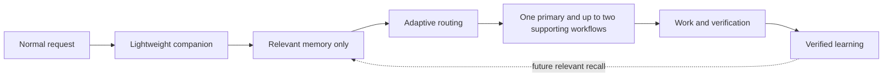

# Version 2 development plan

Version 2 develops this repository in evidence-gated phases. A later phase stays
blocked until the current phase meets its documented checks. Plans describe intended
behaviour; the repository, tests, and recorded trials describe what exists.

## Product direction

The user should be able to describe work normally. A lightweight companion layer
recalls only relevant context, selects a small workflow, completes the authorized
work, verifies the result, and retains only evidence-backed lessons. Internal skill
names and memory commands must not become routine user input.



## Phase gate

| Phase | Scope | Status | Exit evidence |
| --- | --- | --- | --- |
| 0 | Capability baseline | Complete | Ownership matrix, overlap decisions, 20-case routing corpus, validator, unit tests, model-routing evaluation |
| 1 | Companion and router v2 | Complete | 24-case routing and interaction corpus, 48 unit tests, safety pushback, language matching, and bounded always-on context |
| 2 | Memory contract and provider bake-off | Complete | Provider-neutral schema plus measured ai-memory/Engram comparison; privacy and recovery checks pass |
| 3 | Seamless runtime | Complete — Claude live deferred | Codex lifecycle and verified handoff live; DSH lifecycle and confirmed forget live; handoff promotion and confirmed forget implemented; Claude contract-tested and deferred for live credentials |
| 4 | Token optimization | Prototype; runtime integration pending | 63.17% median context reduction on eight synthetic context-retention cases; live answer quality and runtime integration remain unverified |
| 5 | UI/UX intelligence | Complete for tested scope | Three UI skills, enterprise profiles, three stack fixtures, six screenshot baselines, and 47 visual/interactive/source checks |
| 6 | Engineering intelligence and safety | Complete for tested scope | Four focused skills and eight positive/negative domain, specification, security, and transaction cases pass |
| 7 | Cross-agent packaging | Complete for tested scope | Portable export/verify/import/backup/rollback, adapter compatibility, documentation, and license review pass; plugin UI installation remains unverified |

The machine-readable phase state and ownership decisions live in
[`tests/v2_phase_gate.yaml`](../tests/v2_phase_gate.yaml). Tests reject skipped phase
dependencies, missing ownership, unbounded capabilities, and runtime concerns that
are incorrectly presented as user-facing skills.

## Phase 0 result

Phase 0 keeps the existing nine skills unchanged. It establishes:

- one explicit owner, trigger, and non-goal for every current or planned capability;
- recorded boundaries for capabilities that could overlap;
- a representative natural-language routing corpus containing direct, contextual,
  and negative-control cases;
- a reusable read-only model evaluation runner;
- a rule that later phases remain blocked until their immediate dependency passes.

The baseline deliberately classifies memory, context budgeting, tool-output
filtering, and continuous learning as runtime services. It classifies agent-quality
evaluation as repository tooling. Neither category should become a command the user
must remember.

## Phase 1 result

Phase 1 makes the default interaction feel like help from an approachable friend,
not a formal support desk. It matches the user's language and register, welcomes
basic questions and unfinished ideas, continues clear authorized work without asking
again, and uses one concise question only when missing context changes the safe result.

Friendliness does not weaken engineering boundaries. The companion still challenges
shortcuts that risk security, privacy, financial correctness, data integrity, or
recovery, and it never claims human identity, unavailable memory, or evidence that was
not observed. The router also avoids redundant skill chains and keeps an unspecified
“fix the system” request at the general routing layer until a target or symptom exists.

The always-on companion policy is capped at 200 words and the complete consuming
snippet at 640 words. Detailed workflow instructions remain progressively loaded only
when selected. The final model corpus contains 24 natural-language cases, including
casual Indonesian explanation and brainstorming, clear automatic work, ambiguous
choices, missing context, diagnosis-only boundaries, and payment-integrity pushback.
Phase 2 builds on that behaviour without changing the user-facing instructions: the
memory contract is a runtime boundary, not another skill or command.

## Phase 2 result

Phase 2 defines a provider-neutral record and bundle contract, machine-checked by
[`scripts/memory_contract.py`](../scripts/memory_contract.py) and
[`tests/test_memory_contract.py`](../tests/test_memory_contract.py). A record carries
scope, provenance, evidence references, confidence, timestamps, lifecycle status, and
trust. Active records are unique per project and topic; supersession links are checked;
sensitive material is rejected before storage; repository anchors can demote stale
records; and exports carry a canonical checksum.

The bake-off compared ai-memory 3.4.0 and Engram 3.6.2 on the same nine-record,
twelve-query corpus. Both met the hard gates: 12/12 recall after contract filtering,
zero stale or cross-project leaks, no canary in provider storage or export, and
successful delete/restore and restart recovery. Engram additionally supported portable
import and had lower observed setup and query overhead. It is selected for the first
Phase 3 adapter; ai-memory remains a supported alternate. Full measurements and limits
are in [`docs/V2_PHASE2_EVIDENCE.md`](V2_PHASE2_EVIDENCE.md).

The trial does not prove automatic capture, lifecycle hooks, Codex integration,
concurrency safety, or fail-open behaviour. At that historical gate Phase 3 remained
blocked until those were implemented and tested. No memory skill was added, and the nine existing skills are
unchanged.

## Pre-Phase 3 DSH preparation

A DSH compatibility layer was built without opening Phase 3. It uses DSH's native
`.agents/skills` discovery and `AGENTS.md` loading, adds a DSH-specific routing
calibration, and provides an optional Engram MCP bundle with a Host privacy guard. The
standard verification is recorded in
[`docs/DSH_ADAPTER_EVIDENCE.md`](DSH_ADAPTER_EVIDENCE.md).

Phase 3 later completed with the DSH lifecycle plugin and the Codex runtime evidence.

## Phase 3 result (complete; Claude live deferred)

The Codex vertical slice uses the stable Codex lifecycle hooks:

- `SessionStart` recalls bounded Engram context without a memory command;
- `UserPromptSubmit` handles explicit remember, show, project opt-out, and
  confirmation-gated forget controls;
- `Stop` writes a bounded handoff; it is promoted to verified only with linked
  verification evidence;
- missing Engram is fail-open;
- the installer merges hooks idempotently, backs up existing files, preserves
  unrelated hooks, and is reversible.

The standard Codex end-to-end check passed recall, remember, handoff, fail-open,
opt-out, uninstall, privacy, idempotence, rollback, and unrelated-hook preservation.
It used Codex `0.166.0-alpha.6`, `gpt-6.1-sol`, and Engram `3.6.2`; evidence is in
[`docs/CODEX_ADAPTER_EVIDENCE.md`](CODEX_ADAPTER_EVIDENCE.md). The user-level hooks
still require a one-time `/hooks` review.

DSH adds lifecycle hooks through the `@local/dsh-companion-memory` Host plugin:
`agent/pre-step` recall and controls, and `agent/turn-stopping` handoff. The first live
runs failed with `TRANSPORT` because the injected context lacked a complete message
identity and was added before the real prompt. After adding an identified message
during the pre-step and gating it on an actual user prompt, the live disposable run
passed recall, remember, handoff, opt-out, fail-open, and uninstall.

Claude Code adds the same shared runtime through user-level `settings.json` hooks.
Settings merge, recall/remember/opt-out/handoff shapes, fail-open, idempotence,
rollback, and uninstall are tested. No Claude binary or authenticated session was
available, so live Claude model delivery is unverified.

Phase 3 is **complete** with verification `verified-with-deferred-claude`. Handoffs are
now promoted to `verified` only when a verification command and success marker are
linked to the transcript; otherwise they remain `unverified`. `forget` is a two-step,
confirmation-gated deletion. Claude's hook contract is retained and its live
verification is explicitly deferred until credentials are available.

Phase 4 is **in progress**; the prototype measurements and remaining work are below.

## Phase 4 scope (in progress)

Phase 4 must reduce token usage without weakening correctness:

- record a baseline of context tokens, task correctness, and critical constraints;
- add progressive memory summaries and selective retrieval;
- add symbol-level source retrieval;
- filter repetitive tool output while keeping raw evidence recoverable;
- never compress away safety, approval, security, or financial constraints;
- re-run the same task corpus before and after.

The target is at least a 30% median context-token reduction with no material correctness
regression and recoverable raw evidence. The prototype benchmark below does not yet
establish the full runtime or model-answer quality gate.

## Phase 4 result

Phase 4 adds a selective context optimizer and a repeatable token benchmark:

- full memory, tool output, and source are the baseline;
- only project-scoped relevant memory is selected;
- noisy tool/source lines are filtered while command failures, causes, fixes, and tests
  are retained;
- critical constraints are copied verbatim and never summarized;
- complete tool and source evidence is written to a local raw store and referenced as
  `raw://...`;
- an optional `tiktoken` tokenizer measures `o200k_base` tokens; a lexical fallback is
  available if the tokenizer is unavailable.

The eight-case corpus covers billing reconciliation, payment retry, refund approval,
ledger replay, customer export privacy, inventory sync, identity migration, and
release rollback. Results:

| Metric | Result |
| --- | --- |
| Median context reduction | 63.17% |
| Minimum reduction | 60.24% |
| Required facts retained | 8/8 |
| Critical constraints preserved | 8/8 |
| Raw tool evidence recovered | 8/8 |
| Raw source evidence recovered | 8/8 |
| Gate | pass |

The optimizer is currently used by the benchmark, not wired into the agent runtime.
The machine-readable phase gate records Phase 4 as in progress. Phases 5–7 retain
their individually tested completion status, which does not imply Phase 4 passed.
The benchmark no longer feeds expected-answer phrases into context selection. A
synthetic loss probe exposed a dropped non-keyword instruction; the revised selector
preserves non-debug tool lines and source. Two paired model trials (invoice and
payment retry, Codex gpt-6.1-sol) retained the expected phrases in both baseline and
optimized answers. This small sample is not sufficient to certify runtime use.
The measurement is a **context-retention benchmark**, not a live model-answer
benchmark. It proves that the optimized context keeps every declared required fact and
critical constraint and that raw evidence remains recoverable; it does not prove every
model will answer identically. Phase 5, Phase 6, and Phase 7 are complete.

## Phase 5 result

Phase 5 adds three distinct owners:

- `ui-design-intelligence` defines direction, hierarchy, tokens, states, and enterprise
  data behavior;
- `ui-implementation` implements the agreed design in the existing stack;
- `ui-quality-verification` audits visual, responsive, keyboard, accessibility, and
  state quality.

`browser-diagnostics` keeps the unexplained-failure investigation path and explicitly
hands planned audits to `ui-quality-verification` instead of duplicating the audit.

The enterprise profiles cover dense tables, filters, approvals, long forms,
reconciliation, and dense financial data. The fixtures cover plain web, React/Vite, and
Next.js. Six screenshot baselines span 360 and 1440 CSS pixels, and the automated runs
exercise keyboard focus order, filter/selection/bulk approval, responsive reflow, and
empty/loading/error/retry states.

Results:

| Check | Result |
| --- | --- |
| Plain + React checks | 35/35 |
| Next checks | 12/12 |
| Screenshot baselines | 6 |
| Keyboard focus and visible focus | pass |
| 360px and 1440px overflow | pass |
| Empty, loading, error, retry | pass |
| Console errors | none |
| Next production build | pass |

Screenshot comparison is local-Chrome and font-stack dependent. Automated keyboard
checks do not replace a full assistive-technology review. No production data or backend
authorization was tested.

## Phase 6 result

Phase 6 adds four distinct owners:

- `domain-modeling` resolves terms, lifecycle states, events, and invariants;
- `spec-to-code-verification` traces testable requirements to implementation and test
  evidence;
- `skill-security-guard` reviews third-party skills before adoption and never installs
  them automatically;
- `transaction-safe-engineering` is optional and loaded only when money, ledger, batch,
  retry, reconciliation, or idempotency risk exists.

The deterministic checker suite runs eight cases:

| Case | Expected | Result |
| --- | --- | --- |
| Safe skill fixture | no findings | pass |
| Unsafe skill fixture | reject with high-severity findings | pass |
| Valid domain model | accept | pass |
| Invalid domain model | reject | pass |
| Complete specification traceability | accept | pass |
| Missing/orphan requirement references | reject | pass |
| Safe transaction cases | accept | pass |
| Unsafe transaction cases | reject | pass |

These are fixture-level and heuristic checks, not proof of production safety or live
model behaviour. The security scanner is a triage aid, not a complete audit. Phase 7 is complete.

## Phase 7 result

Phase 7 adds the portable, host-neutral skill layer:

```sh
python scripts/package_skill_pack.py export --output dist/skill-pack.zip
python scripts/package_skill_pack.py verify dist/skill-pack.zip
python scripts/package_skill_pack.py import dist/skill-pack.zip --target /path/to/project
python scripts/package_skill_pack.py rollback --backup <backup> --target /path/to/project
```

The pack contains all skills, UI metadata, `AGENTS.snippet.md`, adapter documentation,
license notices, `VERSION`, and a canonical manifest. Export is deterministic; import is
previewable, preserves unrelated skills, and backs up every replaced path. Verification
rejects duplicate members, traversal paths, manifest mismatches, and tampered bytes.

Codex, Claude, and DSH installers retain their own uninstall, backup, and rollback paths.
Their host-specific hooks are deliberately not imported by the portable pack. The
license inventory covers the development/test dependencies and states their limits.

Phase 7 is the final phase. The project is complete for the assessed local scope; host
runtime behavior and live Claude delivery remain scoped by their recorded evidence.

## Advancement rule

To open the next phase:

1. Run every required check for the current phase.
2. Record the environment, expected outcome, observed result, and limitations.
3. Resolve failures caused by the proposed change.
4. Keep the next phase blocked when a required result is missing, inconsistent, or
   materially worse than the baseline.
5. Change the phase state only in the same reviewed change that records the evidence.

Passing structural tests is necessary but not sufficient. Behavioural changes also
need representative model or runtime trials. Token, memory, and quality claims must
be measured against the same task corpus rather than copied from an upstream project.

## Evidence commands

```sh
python scripts/validate_skills.py
python -m unittest discover -s tests -v
python scripts/run_routing_evals.py --model <available-model>
python scripts/run_memory_bakeoff.py --ai-memory-bin <path> --engram-bin <path>
python scripts/build_release.py
```

The model runner uses disposable workspaces, an ephemeral session, a read-only
sandbox, installed repository skills, and the consuming-project instructions. It
scores the structured routing contract, not prose similarity.

## Safety and portability

- Current source and working state override saved memory.
- Memory must be inspectable, forgettable, scoped, and private by default.
- Secrets, customer data, raw logs, and full conversations are not default memory.
- Runtime failure must not silently corrupt context or block ordinary repository work.
- External skills and providers require license, permission, privacy, and supply-chain
  review before adoption.
- ChatGPT, Codex, Claude Code, and other agents receive separate adapters; the plan
  does not assume identical lifecycle hooks.
