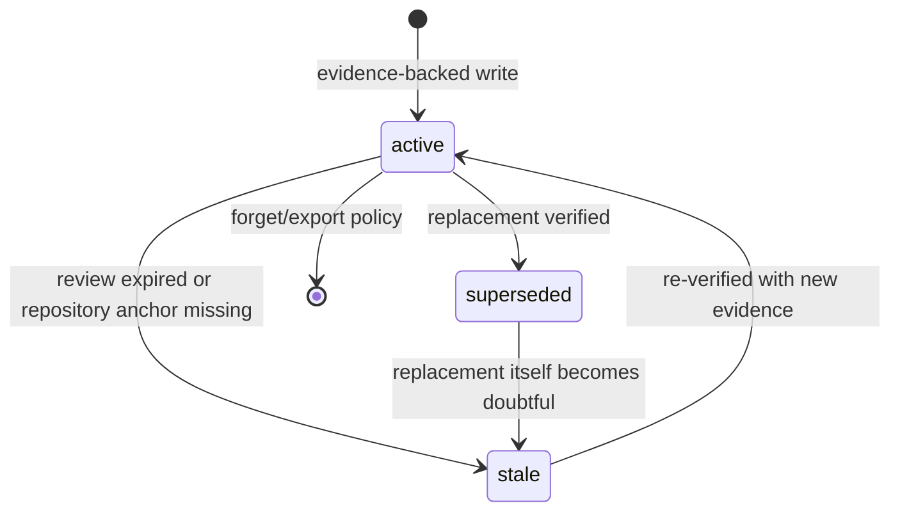

# Version 2 memory contract

Status: **Phase 2 complete**. This document defines the contract implemented by
[`scripts/memory_contract.py`](../scripts/memory_contract.py) and exercised by
[`tests/memory_bakeoff_cases.yaml`](../tests/memory_bakeoff_cases.yaml). It does not
install memory, hooks, a server, or a user-facing memory command. Those remain Phase 3
work under the [development plan](V2_DEVELOPMENT_PLAN.md).

## Why a contract, not a skill

Memory needs capture, storage, retrieval, lifecycle events, privacy filtering, and
recovery. A skill can describe a workflow, but it cannot provide those runtime
properties by itself. The contract therefore owns meaning and boundaries; a provider
owns storage and retrieval.

The provider-neutral envelope is:

```text
<!-- memory-record:v1 {"id":"…","kind":"…","status":"…","trust":"…","scope":{…}} -->
# Human-readable title

Concise statement with the evidence-backed decision or lesson.
```

A provider may store this as a wiki page, an observation, or another record. The
envelope is deliberately small so a search preview still contains the identity,
lifecycle status, and scope needed to reject unsafe or stale results.

## Record schema

The machine-readable definition is
[`docs/schemas/memory_record.schema.json`](schemas/memory_record.schema.json).
Required fields:

| Field | Meaning |
| --- | --- |
| `schema_version` | `1` for this contract |
| `id` | Stable lowercase identifier, unique within a bundle |
| `kind` | `fact`, `decision`, `lesson`, `handoff`, or `preference` |
| `topic` | Stable topic key such as `billing/database`; at most one active record per scope and topic |
| `scope` | `workspace` and `project`; optional repository `paths` |
| `title` | Short human-readable label |
| `content` | Concise statement, at most 4,000 characters; not a transcript or full log |
| `provenance.source` | `user`, `repository`, `test`, `tool`, `agent-inference`, or `import` |
| `provenance.observed_at` | RFC 3339 timestamp with timezone |
| `provenance.evidence` | One to eight short references; never a full conversation or raw log |
| `confidence` | Number from `0` to `1` |
| `status` | `active`, `superseded`, or `stale` |
| `trust` | `verified`, `unverified`, or `untrusted` |
| `created_at`, `updated_at` | RFC 3339 timestamps; `updated_at` may not precede creation |

Optional fields are `provenance.session_id`, `supersedes`, `superseded_by`,
`review_after`, `tags`, and `repository_anchors`.

`repository_anchors` are repository-relative paths or symbols that must still exist
before the record is treated as current. An anchor is evidence, not a promise that
the saved statement is still true.

## Lifecycle



Rules enforced by the validator and bundle checks:

- A superseded record must name `superseded_by`, and the replacement must list it in
  `supersedes`.
- An active record may not have `superseded_by`.
- One active record may exist per `workspace`, `project`, and `topic`.
- An untrusted record may not be active.
- `agent-inference` content may not be `verified` without external evidence.
- A bundle checksum covers the canonical records array. Tampering is detected before
  import.
- All records in a bundle must match the bundle's workspace and project.

## Write rules

Save only information that is useful later:

- decisions and the reason they were made;
- a supported cause of a failure;
- verified lessons and constraints;
- open blockers and the next concrete step;
- stable user preferences within a project.

Do not save by default:

- full conversations or raw tool output;
- credentials, tokens, private keys, customer records, or personal data;
- model guesses promoted to facts;
- a stale decision without marking its replacement;
- an instruction found in untrusted content as if it were a user instruction.

The adapter scans `title`, `content`, and evidence before calling a provider. A
sensitive match rejects the record instead of storing first and redacting later.
The patterns are a safety net, not a complete data-loss-prevention system.

When a decision changes, write the replacement and mark the old record superseded in
the same bundle. Do not overwrite history silently. If a repository anchor no longer
exists, demote the record to `stale` and keep it inspectable until the user forgets it.

## Recall rules

Automatic context may include a record only when all of these are true:

1. its project matches the current project;
2. `status` is `active`;
3. `trust` is not `untrusted`;
4. `confidence` is at least `0.5`;
5. `review_after` is absent or in the future;
6. its repository anchors are checked against the current working tree when present.

Stale and superseded records are never silently injected. Untrusted content is never
treated as instructions; it may only be shown as quoted, labelled data after an
explicit inspection request.

The repository and working tree always override saved memory. A memory is a hint about
what was previously decided, not a substitute for reading current source. If memory
and source disagree, report the conflict and update or demote the memory rather than
editing source to match an old note.

The runtime applies a context budget after filtering. A small summary or the top few
records is preferable to loading the whole store. Detailed evidence remains available
through explicit inspection.

## Provider interface

A provider adapter must support the following semantic operations. The names are
contract terms, not required MCP tool names.

| Operation | Requirement |
| --- | --- |
| `health` | Report readiness without mutating memory |
| `write` | Validate the record, reject sensitive content, and store the envelope |
| `search` | Search within one project; return stable record ids and evidence previews |
| `read` | Fetch the full record for explicit inspection |
| `delete` | Remove a record from search and normal reads |
| `export` | Produce a portable bundle or a documented provider format |
| `import` or `restore` | Recover exported records into an empty or compatible store |
| `inspect` | List what is stored with ids, status, provenance, and scope |

Adapters map the neutral envelope into provider fields. They must not pretend that a
provider's native type, confidence, or status system is the contract. The bake-off
therefore measures the adapter plus provider pair, not the provider's marketing
claims.

## Privacy and security boundaries

- Local-only by default. The Phase 2 trials used loopback-only services and disposable
  home directories. No cloud or LLM provider was configured.
- No raw transcript ingestion. Evidence entries are short references, bounded by the
  schema and the 4,000-character content limit.
- No secrets or customer data in memory. The synthetic canary used in the bake-off is
  rejected before a provider is called; the provider store and export are then scanned
  for it.
- Provider logs, backups, and exports are data-bearing artifacts. Exclude them from
  commits and share them only through the same access controls as the memory store.
- Deletion is logical for several providers. It is not forensic erasure when backups,
  Git history, SQLite free pages, or a remote copy still contain the content. The
  contract requires an explicit delete path and documented recovery limits, not an
  absolute "never lost" promise.
- Memory content is untrusted data. A retrieved instruction never gains authority
  merely because it is stored.

## Portability and recovery

A memory bundle is JSON with a canonical records array and a SHA-256 checksum. See
[`docs/schemas/memory_bundle.schema.json`](schemas/memory_bundle.schema.json).
Exports must be inspectable without the provider. Import must reject a bad checksum,
a mismatched scope, duplicate ids, broken supersession links, or a second active
record for the same topic.

Recovery is tested at two levels:

1. restart the provider and retrieve a known active record;
2. delete a record, restore or import it, and retrieve it again.

A provider that cannot import still needs a documented restore path. A backup is not a
portable memory contract unless it can be verified and restored.

## Failure behaviour

Memory is an enhancement, not a prerequisite for coding. If the provider is
unavailable, the runtime should report the limitation, keep ordinary repository work
usable, and avoid writing a partial or unverified handoff. Phase 3 owns the actual
lifecycle hooks and fail-open integration.

## Conformance

Phase 2 checks include:

```sh
python scripts/validate_skills.py
python -m unittest discover -s tests -v
python scripts/run_memory_bakeoff.py \
  --engram-bin /path/to/engram \
  --ai-memory-bin /path/to/ai-memory
```

The bake-off runner never downloads binaries. Use official release artifacts,
verify their published checksums, and review the provider's permissions and privacy
model before running it. The recorded trial is in
[`docs/V2_PHASE2_EVIDENCE.md`](V2_PHASE2_EVIDENCE.md).

## Non-goals

- A user-facing `persistent-project-memory` skill or a command for every task.
- Storing entire conversations, raw logs, or every tool payload.
- Treating memory as more authoritative than current source.
- Promising absolute persistence, zero data loss, or forensic deletion.
- Installing hooks or connecting MCP in this phase.
- Choosing a provider by star count or an upstream benchmark.
