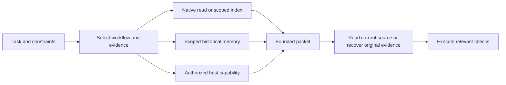

# Context architecture

| Layer | Input | Output and escalation |
| --- | --- | --- |
| Task intelligence | User intent, authorization, phase, known risk | Keep exact constraints and decide whether a single native read, bounded retrieval, or a connected specialist capability is needed |
| Knowledge | Project root, allowlisted files, scoped memory, tool capability | Rank source excerpts, attach identity and line ranges, filter stale and irrelevant memory, and discover a single relevant tool schema |
| Budget | Explicit packet cap, required evidence, original data | Keep exact constraints first; protect evidence anchors and complete required files. A packet that cannot fit them requires expansion or a revised scope |
| Evidence | Current source, observations, commands and typed outcomes | Hydrate from the current revision, recover raw capture by content ID, and report the executed verification separately from material that was only inspected |

LIGHT uses native reads or a transient local index. BALANCED reuses a root-bound SQLite index for repeated retrieval. ADVANCED is a profile for optional graph or semantic retrieval after an isolated comparison establishes value. The current package and installed hosts work with native tools without a new service. Permission and repository boundaries apply identically to all paths.

Tool selection follows the host's capabilities. The catalog helper is available to an initialized client with a transport. It never invokes a tool or enables a server. A fixed host inventory may apply the same sequencing without changing its schema inventory.
