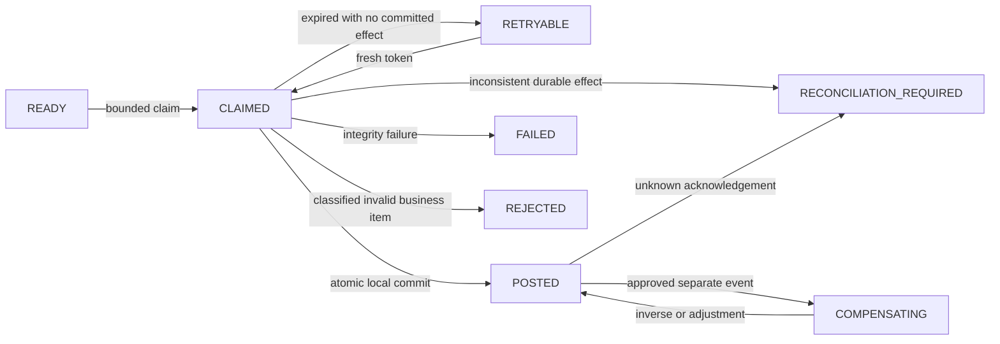

# Staging and posting architecture

The [staging reference](../../.agents/skills/transaction-safe-engineering/references/staging-posting-pipeline.md)
defines each transition, owner, and invariant. The diagram covers the full process.
The PostgreSQL fixture executes the claim, recover, post, replay and unknown-outbox
paths. Its `RECONCILIATION_REQUIRED` state fences an inconsistent expired claim.
Approval and rejection policy depend on the consuming business.

Claim transactions commit before processing. The posting transaction checks
the staging lease, token, owner and fingerprint under a row lock. Journal, two
accounting lines, audit, stage and outbox have one commit. A replay after that
commit returns the existing effect. A concurrent caller cannot create a second
journal for the same key. The external-delivery worker owns its own transaction,
message identity and outcome after the local commit.

Keep an explicit operator-facing reconciliation view for expired, contradictory and
unknown work. Compare amounts and dates at stable scope. Never use an HTTP response,
an empty claim or job metadata as evidence that external settlement completed.
